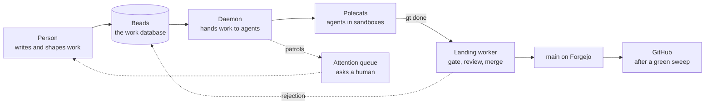
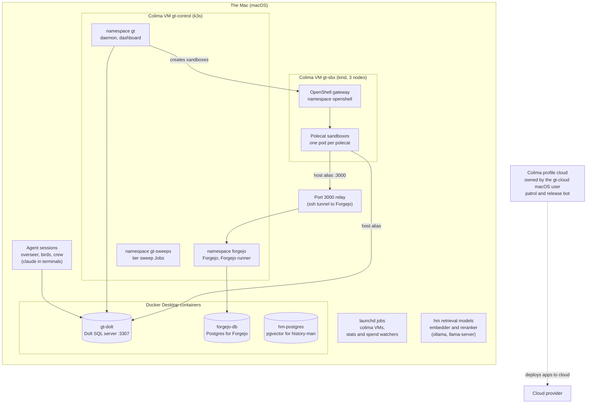
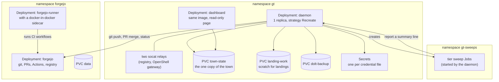
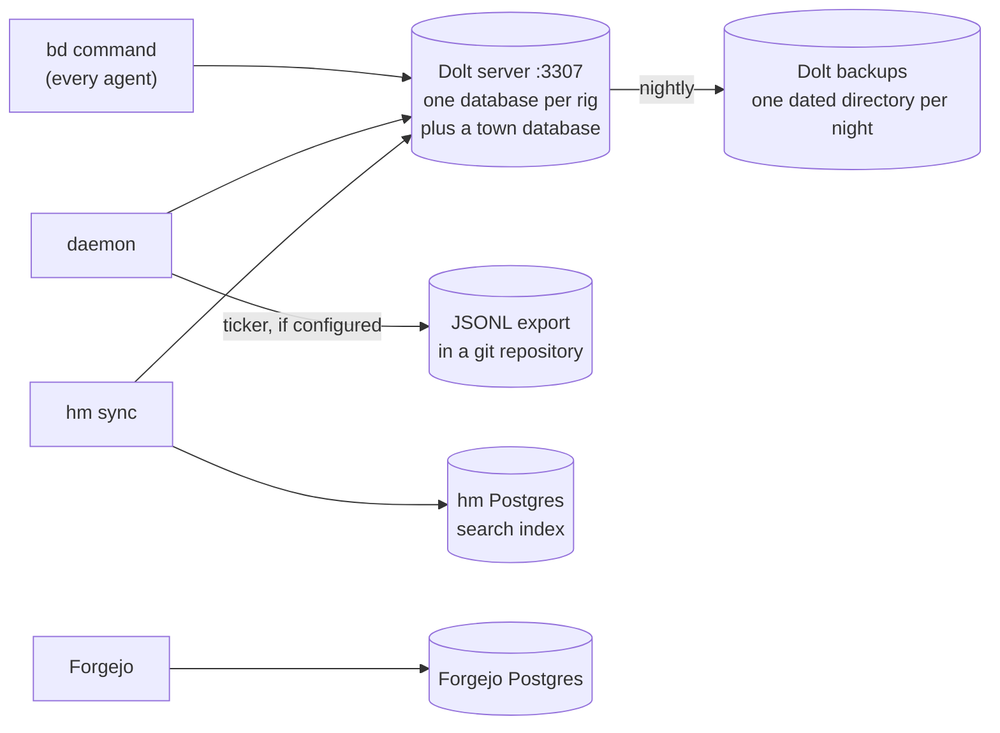
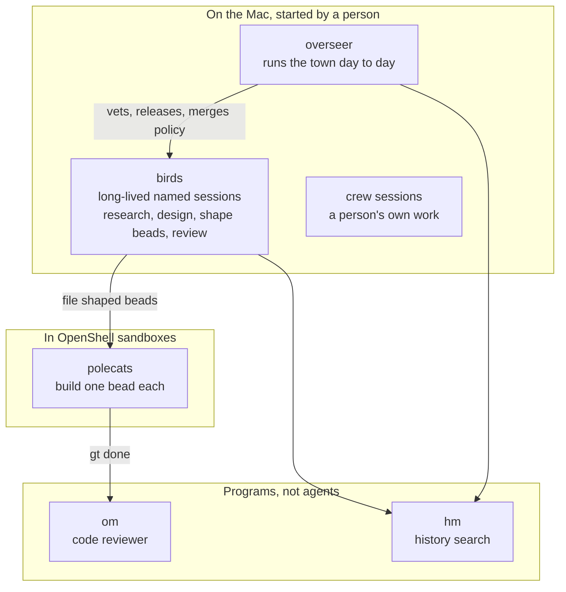
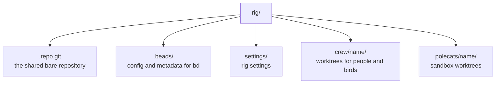
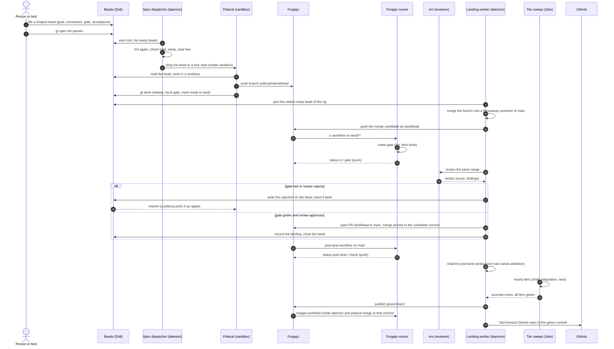
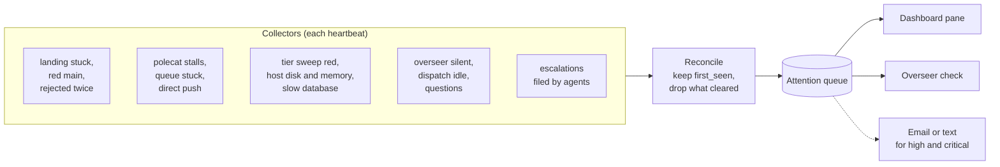
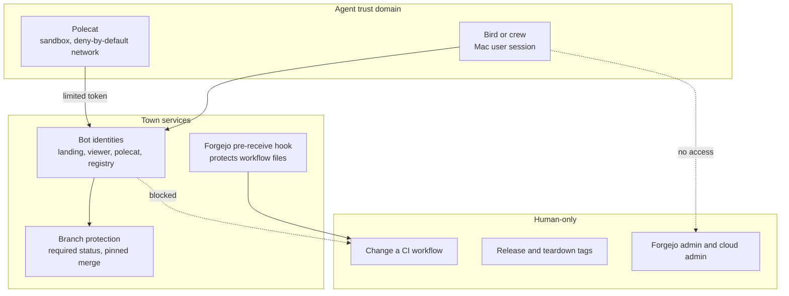

# Gas Town architecture

Gas Town is a system that builds software with a crew of AI agents and a small set of programs that keep them in line. A person writes down work. Agents do it. Programs check it, merge it and publish it. A person watches a few screens and is called in only when a machine cannot decide.

This page explains every moving part as it runs today and how one piece of work travels from an idea to a published commit. It is written for a reader who has never seen the town. Each section starts with a picture and then explains it.

Numbers that change (how many agents may run at once, which versions are installed, how many rigs exist) are not written here. Each place that needs one says where to read it live. See [Reading the live town](#reading-the-live-town).

## Contents

1. [The idea in one page](#the-idea-in-one-page)
2. [The machines](#the-machines)
3. [The control plane](#the-control-plane)
4. [The data plane](#the-data-plane)
5. [The agents](#the-agents)
6. [Rigs and repositories](#rigs-and-repositories)
7. [The life of a piece of work](#the-life-of-a-piece-of-work)
8. [Attention: how the town asks for a human](#attention-how-the-town-asks-for-a-human)
9. [The security model](#the-security-model)
10. [Future work](#future-work)
11. [Reading the live town](#reading-the-live-town)
12. [Terms](#terms)

## The idea in one page

Four ideas carry the whole design.

1. **Work is a bead.** A bead is a record in a database: a title, a description, a state, links to other beads. Every task, bug, review finding and escalation is a bead. Agents read and write beads with the `bd` command, never by editing files.
2. **A shaped bead can be built by a stranger.** A bead that has a goal, constraints, a gate command and a short list of acceptance boxes can be handed to an agent that knows nothing else. A program (`gt spec lint`) checks the shape. Only shaped beads are handed out automatically.
3. **Nothing reaches `main` except through the landing path.** An agent finishes with `gt done`. The daemon, not the agent, merges the work: it builds a candidate, runs the gate on a clean machine, has a reviewer program read it, and only then merges. An agent never pushes to `main`.
4. **The town watches itself.** A set of patrols and checks turn "something is wrong" into an item in one queue, the attention queue. A person looks at that queue instead of at logs.

## The machines

The town runs on one Mac, and almost everything else runs in virtual machines on that Mac.

What each machine does:

- **The Mac.** It hosts the human-facing sessions (the overseer, the birds and any crew session), the launchd jobs that start the virtual machines at login, and a relay on port 3000 that lets the sandboxes and the Mac's own tools reach Forgejo by the name `forgejo`.
- **Docker Desktop.** Three containers live here because they are databases that must survive everything else. `gt-dolt` is the Dolt server that holds every bead. One Postgres holds Forgejo's data. One Postgres with the pgvector extension holds history-man's index.
- **Colima VM `gt-control`.** A single-node k3s cluster, the *control cluster*. It runs the daemon, the dashboard, Forgejo and its runner, and the tier sweep Jobs. Section [The control plane](#the-control-plane) covers it.
- **Colima VM `gt-sbx`.** A three-node kind cluster, the *sandbox cluster*. The OpenShell gateway lives here and creates one pod per running polecat. A sandbox can reach only what its policy allows.
- **The retrieval models.** history-man's embedder and reranker run on the Mac through ollama and llama-server. By the operator's rule they stay local, like Dolt and the Postgres databases.
- **The gt-cloud deployer.** A separate Colima profile, `cloud`, owned by its own macOS user, `gt-cloud`, and started by the launchd job `local.gt-cloud.colima`. Two more launchd jobs run as that user on a schedule: `local.gt-cloud.patrol`, which writes a report and a heartbeat under the shared gt-cloud reports directory, and `local.gt-cloud.releasebot`, the release bot. It holds the cloud-side keys and is kept apart from the rest on purpose. See [Future work](#future-work).

## The control plane

The control plane is what decides, schedules and merges. It runs as ordinary Kubernetes workloads in the control cluster.

### The daemon

The daemon is one long-running program. It does not think about code. It keeps the town moving by running a fixed set of jobs on timers, called ticks or patrols:

- **Spec dispatch.** On a timer (every minute by default) it asks the spec dispatcher to look at ready beads, lint them and hand the clean ones to a free seat.
- **Landing.** One landing worker per rig takes work that is ready to land, one landing at a time within a rig, and rigs in parallel.
- **Patrols.** Small checks for stalled agents, stuck landings, full disks, slow database calls, a silent overseer and the like. Each patrol writes its findings into the attention queue.
- **Maintenance.** The nightly Dolt backup and the other housekeeping run in a scheduled window.
- **Tier sweeps.** The hourly run of the slow test tiers.

The Deployment runs exactly one replica with the `Recreate` strategy, because two daemons must never write the same town at once. It has no shutdown hook. On `SIGTERM` it gets a grace period long enough to finish the landing it is in.

### The town-state claim

The *town-state claim* is a persistent volume that holds the town's files: settings, runtime state, the rigs' bare repositories, locks, the dispatch hold. The daemon owns this copy and runs against it; the dashboard mounts the same state to read it. The Mac still holds a second copy of the town until the `gt-wrap` cutover described under [Future work](#future-work), so a town edit is made in both until then.

The list of which paths belong to the daemon, which to other owners and which are never copied is a manifest in the repository (`deploy/daemon/town-state.yaml`). Tests hold the render of the cluster objects to that manifest, so the volume and the code cannot disagree about what is in it.

### Secrets

Each credential is a Kubernetes Secret created from a file named in a manifest (`deploy/daemon/secrets.yaml`). The kinds of credential are:

- the Forgejo bot tokens (landing and viewer);
- one deploy key per rig that publishes to GitHub;
- the review (om) daemon token;
- the OpenShell gateway material;
- the jev environment, a ledger reader connection string and a Dolt archive key;
- the read-only cloud auditor key used by the cloud check.

Model access is concrete. The Claude seats (`sbx-haiku`), the om reviews, the overseer and the birds run on the Claude Pro Max plan's OAuth sign-in. The DeepSeek seat uses the DeepSeek key, held as a Secret. No raw Anthropic API key exists anywhere in the town.

### Forgejo and its runner

Forgejo is the town's own git forge. It stores the repositories, runs pull requests, runs Actions workflows, and hosts a container registry. Its data is a claim in the control cluster; its database is the Postgres on Docker Desktop.

The *Forgejo runner* executes workflows. It runs beside a docker-in-docker container so a workflow can build images. Workflows ask for the runner label `ci-base`, an image with Go and the tools the gate needs. Three workflow files matter:

| Workflow | Runs on | What it does |
|---|---|---|
| `ci` (`gate.yml`) | a push to `land/**` | Runs `make gate` on the merge candidate. Its result is the required status `ci / gate (push)`. |
| `post-land` | a push to `main` | Runs the post-land check on the landed commit. The landing worker reads its result as the rig's verdict on `main`. |
| `images` | a push to `green/**` | Builds the daemon image and the polecat image at the same commit and labels both. |

The workflow files in Forgejo are protected: only a human account may change them (see [The security model](#the-security-model)). The reviewed text of the `images` workflow lives in `deploy/ci/` and a person copies it into place.

### Tier sweep Jobs

`make gate` is the fast gate every landing runs. Some tests are too slow or too heavy for it: the shell tests, the integration tests and the race detector. The *tier sweep* runs them hourly as Kubernetes Jobs in the `gt-sweeps` namespace. Each Job reports one summary line that the daemon parses. A package runs in a tier sweep when the change touched one of its trigger paths or when the daily run is due. When one sweep cycle covers every tier green, the daemon publishes that commit as a `green/<sha12>` branch, which starts the `images` workflow and enables promotion to GitHub.

### The dashboard

The dashboard is a second Deployment of the same image. It serves one read-only page. A single hub polls the town's files on its own clock and pushes the result to every open browser tab, so a second tab costs nothing and a page nobody has open costs nothing. Nothing publishes it. The operator reaches it with a `kubectl port-forward` from the Mac to the dashboard Deployment (local port 8788 to the pod's 8787) and opens the page in a browser tab. The panes include: Attention, Polecats, Rigs, Landings, om review, Forgejo, Cost, Deploys, Cloud, Machine, Birds, Beads and Events.

## The data plane

The data plane is where facts live. Four stores matter.

- **Dolt on port 3307.** Dolt is a SQL database with git-like history. One server holds a database for each rig's beads and one for the town. Everything that reads or writes a bead goes through `bd`, which talks to this server. A rig's beads directory holds small configuration files; the beads themselves are held by the server. If Dolt is down, the town cannot read its work, so Dolt is the single most important process to keep healthy.
- **Dolt backups.** In a nightly maintenance window the daemon writes a backup of each database into a dated directory, keeps the newest few, and renames a directory to its date only when every database is in it, so a directory with a date is always complete.
- **The JSONL export.** On a timer the daemon can export beads as plain text into a git repository. It is a passive copy for recovery and inspection, not a sync channel.
- **history-man's Postgres.** `hm` indexes beads, docs, review verdicts and commit messages into a Postgres with vector search, so an agent can ask "what did we decide about this" and get ranked sources.
- **Forgejo's Postgres.** Holds Forgejo's own data: users, pull requests, Actions runs.

Git history itself lives in each rig's bare repository (`<rig>/.repo.git`) on the town-state claim, and on Forgejo.

## The agents

An *agent* is a Claude Code session or a similar model session with a name and a job. The town has several kinds. They differ in where they run and what they may touch.

- **Polecats** do the building. A polecat is created for one bead, works in a sandbox pod, finishes with `gt done` and is removed. Polecats run on *seats*: a seat class names a model, a sandbox profile and how many may run at once. The seat classes are defined in `settings/config.json` under `polecat_pool`. Today the classes are a DeepSeek-model class (`sbx-flash`) and a Claude Haiku class (`sbx-haiku`). Read the file for the current classes and caps.
- **The overseer** is a Claude session that runs the town: it releases held beads, reads rejections, decides what a hold or a freeze means, and keeps the dispatch hold file. The emergency stop files are the operator's alone. It is a role, not a supervised process: nothing restarts it. A heartbeat file says whether it is alive, and a patrol raises an attention item if it falls silent.
- **Birds** are long-lived named sessions that work for the operator under the overseer. Each has a handoff bead that holds its mission and where it stopped. Birds research, write designs and docs, shape beads, review work and build work in their own worktrees. A bird follows the same landing path as everyone else and never pushes to `main`.
- **Crew sessions** are a person's own working sessions, each in its own worktree under a rig.
- **om** is the reviewer. It reads a branch or a diff and returns a structured verdict: a score, findings, approve or request changes. The landing path calls it, and the directives it enforces are the same text a polecat reads when it starts.
- **hm** (history-man) is the town's memory search described under [The data plane](#the-data-plane).

Several older roles (mayor, deacon, witness, refinery, boot, dog, steward) are retired. Their files and names remain in old records. Nothing runs them and no current document treats them as live.

### Models

Agent definitions in `settings/config.json` name a command, a model and an environment. The polecat seats use the model their definition names through a provider the sandbox policy allows. Sessions of the overseer, birds and crew run Claude Code on the Mac against the plan sign-in kept in the town's own Claude config directory.

### How a polecat is isolated

A sandbox is a pod created by the OpenShell gateway from a profile (image, cpu and memory limits, a node selector, a cache claim, a network policy and a list of providers). The policy denies by default. A polecat reaches Dolt, Forgejo and a tracker only through named Services in the sandbox cluster, which point at the Mac, and reaches the model through the provider attached to its seat.

## Rigs and repositories

A *rig* is one project the town works on: a git repository plus the town's bookkeeping for it (a bare repository, a beads database, settings, worktrees). The town has rigs for itself, for its helper tools, for the apps it builds and for its operations code.

| Rig | What it holds |
|---|---|
| `gastown` | This system: the `gt` command, the daemon, the landing path, the deploy manifests. |
| `beads` | `bd`, the bead tracker. |
| `om` | The reviewer. |
| `hm` | history-man, the search index. |
| `mango` | A data analysis tool. |
| `devops` | Cloud deploy code and release scripts. |
| `fractals`, `beaver` | Applications the town builds and deploys. |
| `agentlab` | A library and tools for agentic capabilities. |
| `toolbox` | Machine-local tools for the operator. |

### Forgejo first, GitHub second

The town's *primary* remote is its own Forgejo. Landing, review and CI all happen there. GitHub is a published mirror: a rig's `main` is pushed to GitHub only after the town decides the commit is good. The daemon holds one deploy key for each rig that publishes. The rigs that carry a key are listed in `deploy/daemon/secrets.yaml`; the other rigs have no key and stay on Forgejo.

### A rig on disk

For each rig the town keeps a bare repository, the rig's beads directory and its settings. Agents work in worktrees cut from the bare repository: polecats in sandboxes, crew and birds under `<rig>/crew/<name>`. The rig itself is not a checkout, and no agent works in the rig root.

## The life of a piece of work

This is the path of one bead from "someone had an idea" to "the commit is on GitHub and running".

### The steps in words

**1. Shape.** A bead is *shaped* when it has these sections: Goal, Constraints, Out of scope, Gate, Size and Acceptance (one to six checkboxes). `gt spec lint` checks the shape and also checks claims the text makes, such as whether the files it names exist. The spec dispatcher only takes beads that pass.

**2. Dispatch.** Each tick the dispatcher looks for ready beads, lints them, and slings the clean ones to a free seat of the right class. It refuses when a dispatch hold file exists or when an emergency stop file exists for the town or the rig. A fixed list of labels keeps a bead off the dispatcher, such as `overseer-only` and `needs-overseer`; the full list is `excludedLabels` in `internal/specdispatch/dispatch.go`. The dispatcher also skips an unshaped bead (lint refuses it), a deferred bead, and every bead while the dispatch hold is set. So a person can hold a bead until it is released.

**3. Work.** A polecat in a sandbox reads the bead, edits files in its worktree, runs the gate commands the bead names and writes tests. It talks to the town only through `bd` and git.

**4. `gt done`.** The polecat rebases onto the current `main`, runs the gate locally, pushes its branch, and marks the bead ready to land. It does not merge. The polecat's part of the work is finished.

**5. Landing.** The landing worker picks the oldest ready bead of a rig and builds a *merge candidate*: it merges the branch into a throwaway worktree of `main`. The result is pushed as `land/<bead>`. This is what the gate runs on, so the gate sees exactly what would become `main`, not the polecat's pre-rebase view. The landing is a squash: one commit on `main` per bead.

**6. The gate.** The `ci` workflow runs on `land/**` on a clean runner and runs `make gate` (lint, then the fast tests). The required status `ci / gate (push)` must be green. A red gate is a rejection. Nothing lands on a red candidate.

**7. Review.** om reads the same range and returns a verdict. The landing worker posts the verdict, and the merge goes through only for an approval. A change to a path on the risk list carries a risk-path label. It is never a hold: the landing proceeds, and the item stays in the attention queue until a human has reviewed it.

**8. Merge.** The landing worker opens a pull request from `land/<bead>` to `main` and merges it pinned to the candidate commit, so a push that arrives meanwhile cannot slip in. It reads the tip of `main` back, then records the landing three ways: a block on the bead, a line in the rig's append-only landings file, and the bead's close. If the target moved while the gate ran, the candidate is rebuilt and the landing retried. A merge refused with a 405 is for a human, never retried.

**9. Rejection.** A rejection is written on the bead with the findings and the bead goes back for rework. A bead rejected twice raises a *rejected twice* item in the attention queue.

**10. Post-land.** After the merge, the `post-land` workflow runs on `main` and posts a status. The landing worker reads it as the rig's verdict on its own `main`. A red verdict raises a *red main* item in the attention queue.

**11. The tier sweep and the green ref.** The hourly sweep runs the slow tiers. When one cycle shows every tier green for a commit, the daemon publishes `green/<sha12>` on Forgejo.

**12. Images and promotion.** The `images` workflow runs on `green/**` and builds the daemon image and the polecat image at the same commit, then checks that both carry that commit's label, because a daemon and a polecat image from different commits cannot run together. Promotion is a fast-forward push of the green commit to the rig's `main` on GitHub. It is exactly `<commit>:refs/heads/main`: never a force, never another branch or a tag. A failed promotion is recorded and retried at the next green verdict; it never blocks the landing.

**13. The roll.** A new daemon image reaches the cluster by hand today. After a green sweep and a built image pair, a person reads the pair's digests from the Forgejo registry and writes them, with the commit line, into `deploy/values/images.yaml`. The values file holds digests, never tags, so the pod runs exactly the commit the file names. Then `make build`, then `gt town cluster render` into an empty directory, then `kubectl apply` in file order. After the apply the dashboard port-forward is set up again, and until the sandbox image copy is automated (gt-mtiu7g) the polecat image is copied by hand to the sandbox cluster's registry as `localhost:5001/gastown-polecat:dev`. `gt update` does not drive a pod roll yet.

### Human gates inside the path

The path is automatic except at four places:

- a person shapes or approves what enters it (see Dispatch for what keeps a bead off the dispatcher);
- a landing that touches a risk path is reviewed by a human afterwards, through the attention queue;
- changing a CI workflow file is a human act (see [The security model](#the-security-model));
- the roll of a new image onto the cluster is a person's step.

## Attention: how the town asks for a human

The town has far more signals than a person can read. The *attention queue* turns them into one list.

- **Derived, not logged.** Every heartbeat each collector returns the items whose condition is true now. The reconcile step keeps the first time an item was seen, drops items nothing returned any more, and records each change. A condition that stops being true clears by itself.
- **Acknowledgement.** A person or the overseer acknowledges an item with a disposition (what was done). An acknowledged item still counts as open until the condition clears or the item is closed.
- **Escalations.** Any agent can run `gt escalate` with a severity. Every escalation files a bead. High and critical also send email, and critical also sends a text. There is no mayor to route them; the overseer and operator sessions triage the beads.
- **Questions.** An agent that needs a decision from the operator files a question item rather than a chat message, so the question survives the session that asked it.
- **The overseer beat.** The overseer's heartbeat command reads the list of unacknowledged items and refuses to run when it cannot read the acknowledgements, rather than guess.

## The security model

The town runs agents that write and run code, so it assumes an agent can be wrong or compromised and limits what any one agent can do.

**Sandboxes.** A polecat runs in a pod whose policy denies everything by default. Its system paths are read-only and its working directory is writable. Its network reaches only the named Services (Dolt, Forgejo, the tracker, the control-plane host) and the model provider attached to its seat. The policy file says plainly what is still wide: a polecat's Forgejo access reaches any repository, and the Dolt user it holds can open any database. Narrowing those (a Dolt user per polecat, a push rule limited to the polecat's own branch) is open hardening work.

**Bot identities.** Each automated actor has its own Forgejo account with the narrowest token that works: the landing bot pushes `land/**` and merges; polecats push work branches; a viewer reads; a registry bot pushes images. The daemon holds the bot tokens and the per-rig GitHub deploy keys as Secrets, and agents never see a raw secret in their prompts or files.

**The workflow-protect hook.** A workflow file decides what runs on a runner, and some runners hold powerful keys. Forgejo's branch rules do not cover a new branch that adds a workflow file, so the town installs a pre-receive hook, `20-gt-protect-workflows`, in Forgejo itself. It reads two lists: the repositories it protects and the accounts allowed to change workflow files. For any other pusher, it refuses any push that touches `.forgejo/workflows/`, `.gitea/workflows/` or `.github/workflows/` in a protected repository. A pusher it cannot identify counts as not on the list.

**Branch protection.** `main` accepts a change only through a pull request from `land/<bead>` with the required status `ci / gate (push)` green. The merge is pinned to the candidate commit. An agent's direct push to `main` is detected and raises a *direct push* item.

**Guards against silent failure.** Safety checks return one of three answers: pass, fail or unknown. A check that could not read its input never reports pass. This rule closes the old class of defects where "could not check" looked the same as "checked and fine".

**Stop switches.** The *dispatch hold* file stops new work from being handed out. The *ESTOP* files stop dispatch and restarts for the whole town or for one rig. Neither signals a running session. The overseer owns the hold and the operator alone owns the ESTOP files.

**What humans do by hand.** Some acts are reserved for a person on purpose: changing a CI workflow file, pushing release and teardown tags, holding and rotating the Forgejo admin and cloud admin credentials, copying the reviewed `images` workflow into place, and applying new cluster manifests. Some of these acts go through the *auth broker*, `gt-approve`, which runs as its own macOS user, `gt-forge`. Each run is for one named rule: the broker mints one token for it, the operator types the confirmation, the broker revokes the token when the run ends, and the run is logged. The rules in use cover Forgejo provisioning and resync, the cutover and probe programs, and the sources secret. An agent never holds the admin credential.

## Future work

These are stated plans and open questions, not running systems.

- **The `gt-wrap` cutover.** The operator decided on 2026-11-11 that the daemon pod's town-state claim becomes the single town copy. On the Mac, `gt`, `bd`, `om` and `hm` become one thin wrapper (`gt-wrap`, in `cmd/gt-wrap`) that runs the command inside the daemon pod with `kubectl exec`. The Mac keeps `~/.claude` and plain git clones and stops being a second town. It is not cut over today, and until it is, every town edit is made in both copies. The cutover waits on four landings (the wrapper's Kubernetes target, the crew-clone rule with a doctor check, a copy-list fix, and a config-backup patrol), then a dry run of every Mac caller and the operator's word. `gt-wrap rollback` undoes it.
- **The cloud check moves into the daemon pod.** The cloud-check patrol that the gt-cloud user runs today is moving into the daemon pod, with the read-only cloud auditor key held in a Secret in the `gt` namespace (gastown bead `gt-c57pax`).
- **What the gt-cloud deployer becomes.** The deployer is still a Colima profile on the Mac with its own macOS account and launchd jobs, while the rest of the town now runs in the control cluster. What it becomes is undecided: its own Kubernetes cluster, an isolated namespace in the control cluster with its credentials kept apart, or a cloud-side runner. The answer decides where the release bot and the per-app deploy runners live. It is tracked as devops bead `dv-8qse`.
- **Retiring `<rig>/mayor/rig`.** Each rig used to keep a working clone under `mayor/rig` that held its beads directory, directives and plugin source. These are moving to the bare repository, `<rig>/.beads`, `<town>/directives` and a build checkout under `.runtime/`. Until the work is complete a rig may still hold the old directory.

Dolt, the Postgres databases and the retrieval models stay on the Mac by the operator's rule. That rule belongs to the local era. Open question, not a plan: when the town moves to the cloud, where Dolt, Postgres and the retrieval models live is undecided (`~/.claude` bead `claude-q3f.12`). The deploy values already separate a `cloud` environment from the local one (`deploy/k8s/values/cloud`), so the manifests name an environment in one place.

## Reading the live town

Facts that change are read, not written down.

| Question | Where to read it |
|---|---|
| Which rigs exist and their sessions | `gt rig list` |
| How many polecats may run, and of which kind | `polecat_pool` in `settings/config.json` |
| Is dispatch held or stopped | `~/gt/seat-refill.hold`, `~/gt/ESTOP`, `~/gt/ESTOP.<rig>` (presence is the signal) |
| What the daemon runs in the cluster | `kubectl --context colima-gt-control -n gt get deploy,pvc,secret` |
| The sandboxes in use | `kubectl --kubeconfig <town>/.runtime/sbx-k8s/kubeconfig -n openshell get pods` |
| What needs a human | the dashboard's Attention pane, or `gt attention` |
| Is the town healthy | `gt doctor` |
| Which image the pod runs | `deploy/values/images.yaml` |
| What a bead says | `bd show <id>` from the rig that owns its prefix |

## Terms

- **Bead.** A tracked unit of work in the Dolt database, read and written with `bd`.
- **Shaped bead.** A bead with the sections that let an agent build it alone.
- **Rig.** A project the town works on, with its own bare repository and beads database.
- **Polecat.** An agent that builds one bead in a sandbox and ends with `gt done`.
- **Seat.** A slot a polecat runs in. A seat class fixes the model, the sandbox profile and the cap.
- **Overseer.** The Claude session that runs the town day to day.
- **Bird.** A long-lived named Claude session with a handoff bead.
- **Landing.** The daemon's merge of finished work onto `main`.
- **Merge candidate.** The merged tree pushed as `land/<bead>` for the gate to judge.
- **Gate.** The fast test and lint run (`make gate`) that every candidate must pass.
- **Tier sweep.** The hourly run of the slow test tiers.
- **Green ref.** The `green/<sha12>` branch published when a whole sweep cycle is green.
- **Promotion.** The fast-forward push of a green commit to GitHub.
- **Attention queue.** The derived list of conditions that need a human.
- **Hold and ESTOP.** The files that stop dispatch. Owned by the overseer (hold) and the operator (ESTOP).
