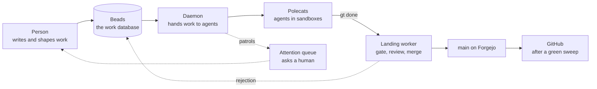
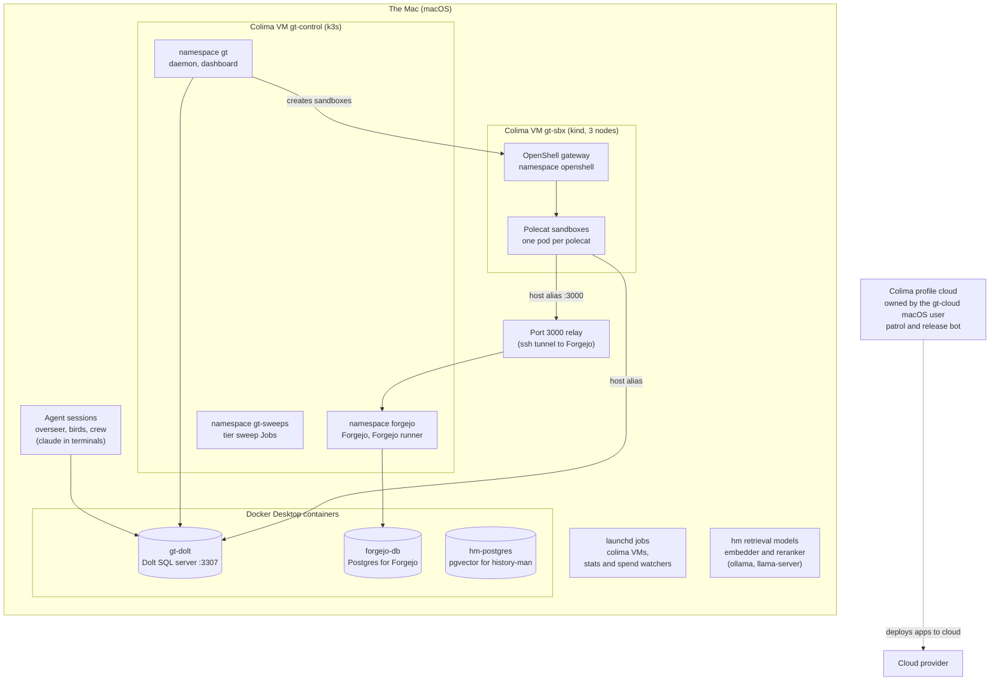
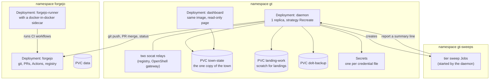
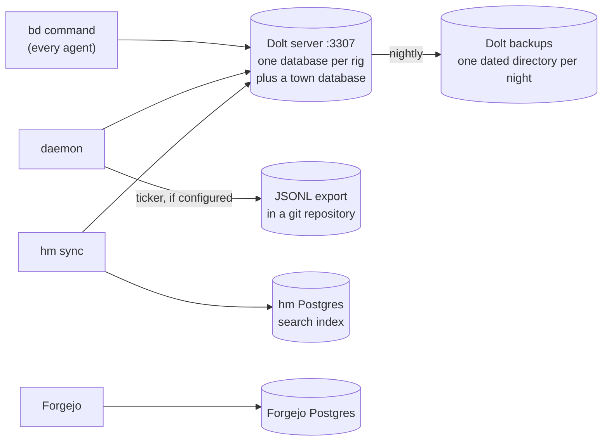
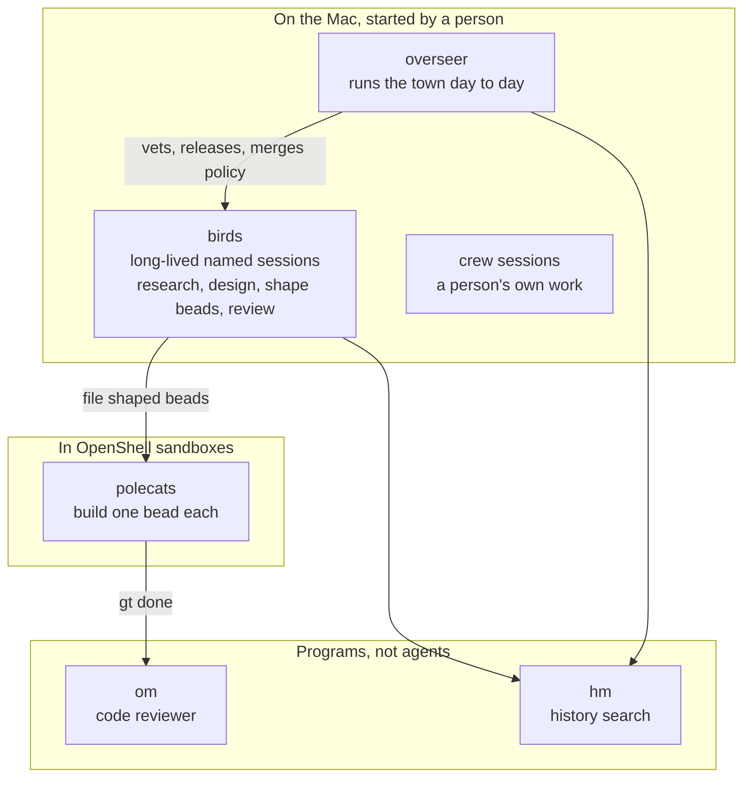
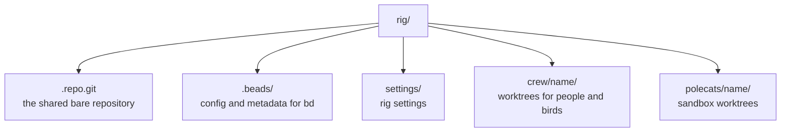
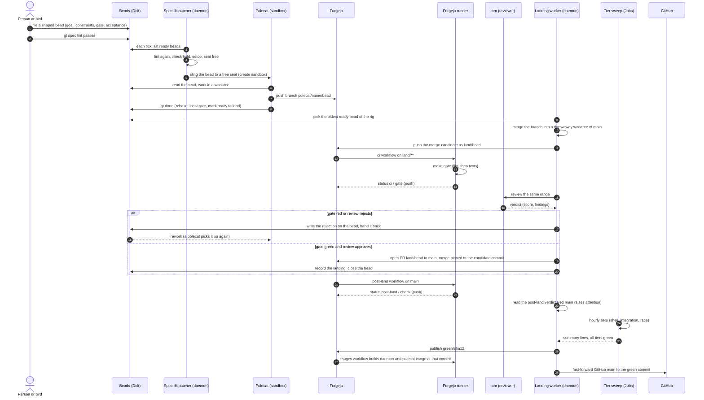
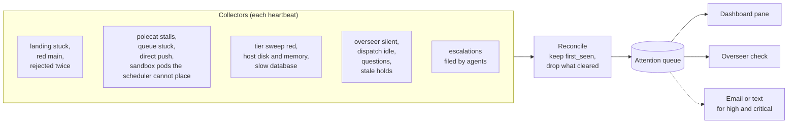
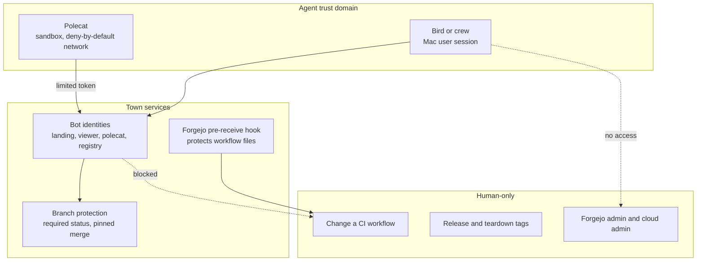

# Gas Town architecture

Gas Town is a system that builds software with a crew of AI agents and a small set of programs that keep them in line. A person writes down work. Agents do it. Programs check it, merge it and publish it. A person watches a few screens and is called in only when a machine cannot decide.

This page explains every moving part as it runs today and how one piece of work travels from an idea to a published commit. It is written for a reader who has never seen the town. Each section starts with a picture and then explains it.

Numbers that change (how many agents may run at once, which versions are installed, how many rigs exist) are not written here. Each place that needs one says where to read it live. See [Reading the live town](#reading-the-live-town).

## Contents

1. [The idea in one page](#the-idea-in-one-page)
2. [The machines](#the-machines)
3. [The control plane](#the-control-plane)
4. [The data plane](#the-data-plane)
5. [The agents](#the-agents)
6. [Rigs and repositories](#rigs-and-repositories)
7. [The life of a piece of work](#the-life-of-a-piece-of-work)
8. [Attention: how the town asks for a human](#attention-how-the-town-asks-for-a-human)
9. [The security model](#the-security-model)
10. [Future work](#future-work)
11. [Reading the live town](#reading-the-live-town)
12. [Terms](#terms)

## The idea in one page

Four ideas carry the whole design.

1. **Work is a bead.** A bead is a record in a database: a title, a description, a state, links to other beads. Every task, bug, review finding and escalation is a bead. Agents read and write beads with the `bd` command, never by editing files.
2. **A shaped bead can be built by a stranger.** A bead that has a goal, constraints, a gate command and a short list of acceptance boxes can be handed to an agent that knows nothing else. A program (`gt spec lint`) checks the shape. Only shaped beads are handed out automatically.
3. **Nothing reaches `main` except through the landing path.** An agent finishes with `gt done`. The daemon, not the agent, merges the work: it builds a candidate, runs the gate on a clean machine, has a reviewer program read it, and only then merges. An agent never pushes to `main`.
4. **The town watches itself.** A set of patrols and checks turn "something is wrong" into an item in one queue, the attention queue. A person looks at that queue instead of at logs.

## The machines

The town runs on one Mac, and almost everything else runs in virtual machines on that Mac.

What each machine does:

- **The Mac.** It hosts the human-facing sessions (the overseer, the birds and any crew session), the launchd jobs that start the virtual machines at login, and a relay on port 3000 that lets the sandboxes and the Mac's own tools reach Forgejo by the name `forgejo`.
- **Docker Desktop.** Three database containers live here because they must survive everything else. `gt-dolt` is the Dolt server that holds every bead. One Postgres holds Forgejo's data. One Postgres with the pgvector extension holds history-man's index. A fourth container, the bd gateway `gt-bd`, is not a database but a front for `bd`; it is defined beside `gt-dolt` in the compose unit `deploy/data/docker-compose.yml` (project `gt-data`), and its image is named by the `BD_IMAGE` digest reference, never a tag.
- **The Dolt compose unit.** `gt dolt start`, `stop` and `status` with `--compose-unit` operate that unit, and it bind-mounts host paths into its containers: the Dolt data and backup directories, the Dolt config file and the gateway token directory. Before changing the compose file or any of those mounts, read [the compose unit](design/bd-container.md#the-compose-unit) in the bd container design.
- **Colima VM `gt-control`.** A single-node k3s cluster, the *control cluster*. It runs the daemon, the dashboard, Forgejo and its runner, and the tier sweep Jobs. Section [The control plane](#the-control-plane) covers it.
- **Colima VM `gt-sbx`.** A three-node kind cluster, the *sandbox cluster*. The OpenShell gateway lives here and creates one pod per running polecat. The gateway and the agent-sandbox controller run Guaranteed (requests equal limits), so the kubelet evicts them last under memory pressure; [the sandbox cluster design](design/k8s-sandboxes.md) has the sizes. A sandbox can reach only what its policy allows.
- **The retrieval models.** history-man's embedder and reranker run on the Mac through ollama and llama-server. By the operator's rule they stay local, like Dolt and the Postgres databases.
- **The gt-cloud deployer.** A separate Colima profile, `cloud`, owned by its own macOS user, `gt-cloud`, and started by the launchd job `local.gt-cloud.colima`. Two more launchd jobs run as that user on a schedule: `local.gt-cloud.patrol`, which writes a report and a heartbeat under the shared gt-cloud reports directory, and `local.gt-cloud.releasebot`, the release bot. A third job, the cloud query runner `local.gt-cloud.cloudquery`, starts when a request file lands in the shared queries directory and writes its answer under the shared reports directory: it is how the town reads cloud state without holding a cloud key. It holds the cloud-side keys and is kept apart from the rest on purpose. See [Future work](#future-work).

## The control plane

The control plane is what decides, schedules and merges. It runs as ordinary Kubernetes workloads in the control cluster.

### The daemon

The daemon is one long-running program. It does not think about code. It keeps the town moving by running a fixed set of jobs on timers, called ticks or patrols:

- **Spec dispatch.** On a timer (every minute by default) it asks the spec dispatcher to look at ready beads, lint them and hand the clean ones to a free seat.
- **Landing.** One landing worker per rig takes work that is ready to land, one landing at a time within a rig, and rigs in parallel.
- **Patrols.** Small checks for stalled agents, stuck landings, full disks, slow database calls, a silent overseer and the like. Each patrol writes its findings into the attention queue.
- **Overrun guard.** `daemon.patrols.overrun_guard` marks a seat that has run past `nudge_after` and stops it at `stop_after`. The mark records the run as nudged and queues the progress battery's pass, and the guard sends the seat no message: only the stop acts. A sandbox seat's real clone is inside its sandbox; the worktree on the pod side is a stale stub. So the stop saves the work inside the sandbox first: it commits uncommitted work as a work-in-progress commit and pushes the branch through the same in-sandbox git the sandbox pusher uses, before the sandbox is removed, then hands the bead back labelled `needs-split`. If the sandbox is already gone and origin holds the branch, the stop proceeds. If origin does not hold it, the stop logs a warning that names the seat and the branch, raises an attention item and hands the bead back. If origin cannot be read, the stop keeps the bead and tries again up to a bound, then hands it back with a high-severity item (`internal/daemon/overrun_guard_stop.go`; the design is `docs/plans/2026-11-14-overrun-sandbox-save-design.md`).
- **Seat checks.** The polecat-health pass reads each seat's session every few minutes. A seat with a hooked bead whose session cannot be read for five minutes raises `seat-unreachable:<rig>/<name>` in the attention queue, naming its bead and its last error, and one good read clears it. A seat with no hooked bead raises nothing (`internal/daemon/seat_unreachable_patrol.go`).
- **Maintenance.** The nightly Dolt backup and the other housekeeping run in a scheduled window.
- **Tier sweeps.** The hourly run of the slow test tiers.
- **Update.** The update patrol, off until `daemon.patrols.update.enabled` is set. In a pod it starts the roll as a Kubernetes Job, and holds it while main's tip is red, its verdict is unreadable or still pending past the bound in `internal/daemon/update_job.go`, or a previous roll's Job or run is unfinished; `docs/guides/gt-update.md` has the pod facts, and `deploy/k8s/update-rbac.yaml` has what that Job can reach. The Job's containers set git's credential helper in their environment, so the `ls-remote` that reads main's tip authenticates with the viewer token the Job mounts; that token is the only Secret the Job mounts, and it is mounted read-only.
- **Cloud check.** The `cloud_check` patrol runs the devops `cloudcheck` binary, which the daemon image carries, on its own interval. It is opt-in: it runs only when `daemon.patrols.cloud_check.enabled` is set, and it is off by default. A run without its key does nothing. Its status file is written to the town state, where the dashboard's Cloud pane reads it (`internal/daemon/cloud_check.go`).
- **Sandbox sampler.** The `sandbox_sampler` patrol reads every live sandbox seat through the sandbox gateway and appends one row per seat to the metrics day file, the sandbox series beside the host rows. It is opt-in and off by default, turned on only by `daemon.patrols.sandbox_sampler.enabled`, because each tick pays one exec per live seat through the gateway. It runs a ticker of its own, 60 seconds unless `daemon.patrols.sandbox_sampler.interval` sets another, no shorter than 5 seconds, rather than the minutes-apart heartbeat. A tick that cannot read the seats, or that reaches its own bound first, writes nothing and logs one line, so a failed tick never reads as a cluster with no seat (`internal/daemon/sandbox_sampler.go`).
- **Image pins.** The `image_pins` patrol keeps the daemon image pins current without a hand bump. It is opt-in and off by default, turned on only by `daemon.patrols.image_pins.enabled`, because each tick reads four source tips over the network. It runs a ticker of its own, 30 minutes unless `daemon.patrols.image_pins.interval` sets another, no shorter than a minute, rather than the minutes-apart heartbeat. A tick reads the pins file from the gt build checkout, asks each pin's source over `git ls-remote` and the town's Forgejo how far it trails, and files one refresh bead for the pins that trail. The tick writes neither pins file, so the refresh itself is a polecat's landing. A failed tick is logged and raises `image-pins-unreadable`; a pin at the stale bound raises `image-pins-stale`, and a refresh bead left unlanded raises `image-pins-refresh-stuck` (`internal/daemon/image_pins_patrol.go`).
- **DeepSeek balance.** The `deepseek_balance` patrol runs a ticker of its own. It is opt-in and off by default, turned on only by `daemon.patrols.deepseek_balance.enabled`, because each tick spends a request against the account's key. It ticks every 10 minutes unless `daemon.patrols.deepseek_balance.interval` sets another, no shorter than a minute. The key is read from the file `daemon.patrols.deepseek_balance.key_file` names, by default the path the daemon pod's key Secret mounts at. A town with no key file is unconfigured: the tick logs one line that says so, once per absence, and fetches nothing. A key file that sets no key, or cannot be read, is an error line, never the unconfigured line. The key never reaches a log line or an error. Until the fetch is wired, a configured tick refuses rather than reporting a balance it did not read (`internal/daemon/deepseek_balance_patrol.go`).
- **om-lessons.** The `om_lessons` patrol runs a ticker of its own for the rework program's lessons loop (`docs/design/rework-program.md`, lever 3). It is opt-in and off by default, turned on only by `daemon.patrols.om_lessons.enabled`, because its pass proposes directive-edit beads on the operator's behalf. It ticks every week unless `daemon.patrols.om_lessons.interval` sets another, no shorter than an hour. Each tick calls one run seam that builds the week's proposals; until the beads that read the review records and file the drafts land, that seam returns no proposals. The ticker is in process, so a restart restarts its cadence (`internal/daemon/om_lessons_patrol.go`).
- **Workspace reconcile.** When `BD_GATEWAY_URL` names a bd gateway, the daemon pushes the town's workspace to it once at start and again on every `patrols.workspace_reconcile.interval` (the default is `DefaultWorkspaceReconcileInterval` in `internal/config/daemon_config.go`). A failed push is logged and retried at the next tick, and it never delays the start. A refused interval is logged by name and the default is used, so a bad setting never turns the reconcile off. `patrols.workspace_reconcile.enabled: false` turns it off. With no gateway named the daemon does not push at all (`internal/daemon/workspace_reconcile.go`; the design is in `docs/design/bd-container.md`, "The workspace").

The Deployment runs exactly one replica with the `Recreate` strategy, because two daemons must never write the same town at once. It has no shutdown hook. On `SIGTERM` it gets a grace period long enough to finish the landing it is in.

With `--daemon-bd-gateway-url` the daemon's bd forwarder points at the bd gateway: the Deployment carries `BD_GATEWAY_URL` and `BD_GATEWAY_TOKEN_FILE`, and mounts the daemon-class token Secret (`bd-gateway-daemon`) read-only at `/run/gt/bd-gateway`. The render names that Secret and never creates it, and no token value reaches a manifest; the operator creates the Secret before the apply. The dashboard's read-class Secret is its own, as [the dashboard](#the-dashboard) describes. Without the flag the Deployment is unchanged.

The daemon container also carries `STORYPOINTS_EMBED_URL`, the host's Ollama at the name the pod reaches the host by (`StorypointsEmbedURL` in `deploy/k8s/daemon/daemon.go`), which the weekly story-points retrain embeds through: without it the retrain reads its own default, the process loopback, which in the pod is the pod itself, so the run fails. The dashboard carries none, as it runs no retrain, and a pod with no hostAlias carries none, since that name resolves in the pod only through the alias.

The daemon is granted the right to start the pod update's Job, so the roll outlives the pod it replaces. Through that Job it reaches the update ServiceAccount's grants and every Secret in `gt`, and it can run any image the nodes pull. The reason it is accepted is in the header of `deploy/k8s/update-rbac.yaml`, and what bounds it is in the header of `deploy/k8s/update-admission.yaml`.

### The town-state claim

The *town-state claim* is a persistent volume that holds the town's files: settings, runtime state, the rigs' bare repositories, locks, the dispatch hold. It is the one town copy. The daemon owns it and runs against it; the dashboard mounts the same state to read it. The Mac is not a town: its `gt`, `bd`, `om` and `hm` are one thin wrapper (`gt-wrap`, in `cmd/gt-wrap`) that runs the command in the daemon pod with `kubectl exec`, except a call its config covers as native, which runs on the Mac (below), and the Mac keeps `~/.claude` and plain git clones. The pod mounts the claim at the same `~/gt` path the Mac used, so the two are easy to confuse: a town edit is made in the pod, and a file under the Mac's `~/gt` is not one the pod reads. The pod's town root may differ from the Mac's; when it does, the wrapper rewrites the pod root to the Mac root in the tool's stdout and stderr so a path the tool prints still works on the Mac. Before editing that rewriter, read `docs/design/gt-in-container.md`, which holds its rules.

A call the wrapper's config covers under its `native` key runs on the Mac with that tool's own binary, not in the pod. Before editing which calls run natively, read [Native calls](design/gt-in-container.md#native-calls), which holds the set and why each call is on it.

The wrapper's `bddocker` target runs a Mac `bd` call inside the local bd container (`gt-bd` in the compose unit), through the gateway's `exec` mode, so the call is checked and logged as it is over HTTP. It refuses when that container is absent, stopped or unhealthy. The target and its config are in `docs/design/bd-container.md`.

The daemon image's `bd` is the real binary with no wrapper in front of it, and so is the bd gateway image's: `deploy/bd/Dockerfile.bd` links `/usr/local/bin/bd` to the real bd the base puts at `bd.real`. The bd shim that routes tracker rigs is deferred with the tracker program and ships in neither image.

The list of which paths belong to the daemon, which to other owners and which are never copied is a manifest in the repository (`deploy/daemon/town-state.yaml`). Tests hold the render of the cluster objects to that manifest, so the volume and the code cannot disagree about what is in it.

The claim carries each rig's bare repository (`<rig>/.repo.git`), not a canonical clone: `<rig>/mayor/rig` is retired, so the manifest has no row for it, the seed and export carry none, and `gt town state verify` reports a clone a tree still holds as information until the operator removes it (`gt rig retire-mayor`).

### Secrets

Each credential is a Kubernetes Secret created from a file named in a manifest (`deploy/daemon/secrets.yaml`). The kinds of credential are:

- the Forgejo bot tokens (landing and viewer);
- one deploy key per rig that publishes to GitHub;
- the review (om) daemon token;
- the OpenShell gateway material;
- the jev environment, a ledger reader connection string and a Dolt archive key;
- the read-only cloud auditor key used by the cloud check;
- the DeepSeek balance key the `deepseek_balance` patrol reads.

The DeepSeek balance key is created from `deepseek.env` in the operator's config directory rather than from a `deploy/daemon/secrets.yaml` entry: `gt town cluster render` mounts it at the patrol's default key file, and prints its create line, only when that file is present, so a town without the key runs the patrol unconfigured.

The bd gateway tokens are the exception to "created from a file named in a manifest": the operator creates each token's Secret before the apply, and the render only names it. The dashboard's read-class token is one of them (see [The dashboard](#the-dashboard)).

Model access is concrete. The Claude seats (`sbx-haiku`), the om reviews, the overseer and the birds run on the Claude Pro Max plan's OAuth sign-in. The DeepSeek seat uses the DeepSeek key, held as a Secret. No raw Anthropic API key exists anywhere in the town.

### Forgejo and its runner

Forgejo is the town's own git forge. It stores the repositories, runs pull requests, runs Actions workflows, and hosts a container registry. Its data is a claim in the control cluster; its database is the Postgres on Docker Desktop.

The *Forgejo runner* executes workflows. It runs beside a docker-in-docker container so a workflow can build images. Workflows ask for the runner label `ci-base`, an image with Go and the tools the gate needs. Three workflow files matter:

| Workflow | Runs on | What it does |
|---|---|---|
| `ci` (`gate.yml`) | a push to `land/**` | Runs `make gate` on the merge candidate. Its result is the required status `ci / gate (push)`. |
| `post-land` | a push to `main` | Runs the post-land check on the landed commit. The landing worker reads its result as the rig's verdict on `main`. |
| `images` | a push to `green/**` | Builds the daemon image and the polecat image at the same commit and labels both. |

The workflow files in Forgejo are protected: only a human account may change them (see [The security model](#the-security-model)). The reviewed text of the `images` workflow lives in `deploy/ci/` and a person copies it into place.

### Tier sweep Jobs

`make gate` is the fast gate every landing runs. Some tests are too slow or too heavy for it: the shell tests, the integration tests and the race detector. The *tier sweep* runs them hourly as Kubernetes Jobs in the `gt-sweeps` namespace. Each Job reports one summary line that the daemon parses. A package runs in a tier sweep when the change touched one of its trigger paths or when the daily run is due. When one sweep cycle covers every tier green, the daemon publishes that commit as a `green/<sha12>` branch, which starts the `images` workflow and enables promotion to GitHub.

### The dashboard

The dashboard is a second Deployment of the same image. It serves one read-only page. A single hub polls the town's files on its own clock and pushes the result to every open browser tab, so a second tab costs nothing and a page nobody has open costs nothing. Nothing publishes it. The operator reaches it through the launchd job `com.gastown.forward-dashboard`, a `kubectl port-forward` from the Mac to the dashboard Service (local port 8787 to the pod's 8787) that launchd restarts when a roll replaces the pod; `gt town forward plist` prints the job. The page opens at `http://127.0.0.1:8787/`, and the same address serves the page's state feed, `/api/state`. With `--bd-gateway-url` the dashboard's bd forwarder points at the bd gateway, and the dashboard mounts its own read-class token Secret (`bd-gateway-dashboard`) read-only. The Secret holds the read-class token only, and no dashboard manifest mounts the daemon's Secret (`bd-gateway-daemon`). The panes include: Birds, Attention, Events, Cost, Rigs, Tier sweeps, Beads, Machine, Cloud, Forgejo, om review, Landings and Polecats, plus the JEV and Mango panes and a Hacker News pane.

### The tracker

The tracker is an issue service the town owns: `trackerd`, a Postgres-backed program rendered beside the daemon and the dashboard when `gt town cluster render --tracker` runs in a live render. The render names the Secret whose `dsn` key holds the connection string and never reads the DSN. `--tracker-backup` adds the nightly dump: a CronJob whose pod runs `trackerbackup` in the postgres image the caller names, writes the dumps into the `tracker-backup` claim, keeps the newest few, and forbids a run that starts while one is still going. It also writes a reader Pod that mounts the claim read-only: the CronJob's pods exit when a run ends, so nothing else holds the claim for a copy. Before relying on a dump, read [Restoring the tracker database from a nightly dump](tracker-restore.md), which copies one out and restores it.

When the tracker is rendered, the daemon container carries `TRACKER_URL`, the trackerd Service's address, so the daemon and every `gt` and `bd` it starts reach the tracker without a per-process file. The render refuses a `Values.Env` entry that sets `TRACKER_URL`, since the pod sets it from `Values.Tracker` itself.

trackerd's requests and limits come from its own pair in `deploy/k8s/daemon/daemon.go` (`trackerResourceRequests` and `trackerResourceLimits`), not from the daemon's `Values.CPU` and `Values.Memory`. Those are sized for the whole town, and a tracker pod that asked for them left the control node too little room for a tier-sweep Job (gt-pau2nv).

## The data plane

The data plane is where facts live. Four stores matter.

- **Dolt on port 3307.** Dolt is a SQL database with git-like history. One server holds a database for each rig's beads and one for the town. Everything that reads or writes a bead goes through `bd`, which talks to this server. A rig's beads directory holds small configuration files; the beads themselves are held by the server. If Dolt is down, the town cannot read its work, so Dolt is the single most important process to keep healthy.
- **Dolt backups.** In a nightly maintenance window the daemon writes a backup of each database into a dated directory, keeps the newest few, and renames a directory to its date only when every database is in it, so a directory with a date is always complete.
- **The JSONL export.** On a timer the daemon can export beads as plain text into a git repository. It is a passive copy for recovery and inspection, not a sync channel.
- **history-man's Postgres.** `hm` indexes beads, docs, review verdicts and commit messages into a Postgres with vector search, so an agent can ask "what did we decide about this" and get ranked sources.
- **Forgejo's Postgres.** Holds Forgejo's own data: users, pull requests, Actions runs.

Git history itself lives in each rig's bare repository (`<rig>/.repo.git`) on the town-state claim, and on Forgejo.

## The agents

An *agent* is a Claude Code session or a similar model session with a name and a job. The town has several kinds. They differ in where they run and what they may touch.

- **Polecats** do the building. A polecat is created for one bead, works in a sandbox pod, finishes with `gt done` and is removed. Polecats run on *seats*: a seat class names a model, a sandbox profile and how many may run at once. The seat classes are defined in `settings/config.json` under `polecat_pool`. Today the classes are a DeepSeek-model class (`sbx-flash`) and a Claude Haiku class (`sbx-haiku`). Read the file for the current classes and caps.
- **The overseer** is a Claude session that runs the town: it releases held beads, reads rejections, decides what a hold or a freeze means, and keeps the dispatch hold file. The emergency stop files are the operator's alone. It is a role, not a supervised process: nothing restarts it. A heartbeat file says whether it is alive, and a patrol raises an attention item if it falls silent.
- **Birds** are long-lived named sessions that work for the operator under the overseer. Each has a handoff bead that holds its mission and where it stopped. Birds research, write designs and docs, shape beads, review work and build work in their own worktrees. A bird follows the same landing path as everyone else and never pushes to `main`.
- **Crew sessions** are a person's own working sessions, each in its own worktree under a rig.
- **om** is the reviewer. It reads a branch or a diff and returns a structured verdict: a score, findings, approve or request changes. The landing path calls it, and the directives it enforces are the same text a polecat reads when it starts.
- **hm** (history-man) is the town's memory search described under [The data plane](#the-data-plane).

Several older roles (mayor, deacon, witness, refinery, boot, dog, steward) are retired. Their files and names remain in old records. Nothing runs them and no current document treats them as live.

### Models

Agent definitions in `settings/config.json` name a command, a model and an environment. The polecat seats use the model their definition names through a provider the sandbox policy allows. Sessions of the overseer, birds and crew run Claude Code on the Mac against the plan sign-in kept in the town's own Claude config directory.

### How a polecat is isolated

A sandbox is a pod created by the OpenShell gateway from a profile (image, cpu and memory limits, a node selector, a cache claim, a network policy and a list of providers). The policy denies by default. A polecat reaches Dolt, Forgejo and a tracker only through named Services in the sandbox cluster, which point at the Mac, and reaches the model through the provider attached to its seat.

## Rigs and repositories

A *rig* is one project the town works on: a git repository plus the town's bookkeeping for it (a bare repository, a beads database, settings, worktrees). The town has rigs for itself, for its helper tools, for the apps it builds and for its operations code.

| Rig | What it holds |
|---|---|
| `gastown` | This system: the `gt` command, the daemon, the landing path, the deploy manifests. |
| `beads` | `bd`, the bead tracker. |
| `om` | The reviewer. |
| `hm` | history-man, the search index. |
| `mango` | A data analysis tool. |
| `devops` | Cloud deploy code and release scripts. |
| `fractals`, `beaver` | Applications the town builds and deploys. |
| `agentlab` | A library and tools for agentic capabilities. |
| `toolbox` | Machine-local tools for the operator. |

### Forgejo first, GitHub second

The town's *primary* remote is its own Forgejo. Landing, review and CI all happen there. GitHub is a published mirror: a rig's `main` is pushed to GitHub only after the town decides the commit is good. The daemon holds one deploy key for each rig that publishes. The rigs that carry a key are listed in `deploy/daemon/secrets.yaml`; the other rigs have no key and stay on Forgejo.

### A rig on disk

For each rig the town keeps a bare repository, the rig's beads directory and its settings. Agents work in worktrees cut from the bare repository: polecats in sandboxes, crew and birds under `<rig>/crew/<name>`. The rig itself is not a checkout, and no agent works in the rig root.

## The life of a piece of work

This is the path of one bead from "someone had an idea" to "the commit is on GitHub and running".

### The steps in words

**1. Shape.** A bead is *shaped* when it has these sections: Goal, Constraints, Out of scope, Gate, Size and Acceptance (one to six checkboxes). `gt spec lint` checks the shape and also checks claims the text makes, such as whether the files it names exist. The spec dispatcher only takes beads that pass.

**2. Dispatch.** Each tick the dispatcher looks for ready beads, lints them, and slings the clean ones to a free seat of the right class. It refuses when a dispatch hold file exists or when an emergency stop file exists for the town or the rig. A fixed list of labels keeps a bead off the dispatcher, such as `overseer-only` and `needs-overseer`; the full list is `excludedLabels` in `internal/specdispatch/dispatch.go`. The dispatcher also skips an unshaped bead (lint refuses it), a deferred bead, and every bead while the dispatch hold is set. So a person can hold a bead until it is released. Three more holds apply before a sling. The story-point estimator's answer: an estimate at or over `story_points.split_over_minutes` labels the bead `split` and holds it for a person to split into smaller beads, except a bead that carries the `rework` label, whose work already sits on a branch. A bead whose spec names a test file that another in-flight bead names waits until that bead closes. And the dispatcher refuses to sling when the pool's total of live seats is full.

**3. Work.** A polecat in a sandbox reads the bead, edits files in its worktree, runs the gate commands the bead names and writes tests. It talks to the town only through `bd` and git.

**4. `gt done`.** The polecat rebases onto the current `main`, runs the gate locally, pushes its branch, and marks the bead ready to land. It does not merge. The polecat's part of the work is finished. The branch push is leased. When origin's tip is not an ancestor of the local head — an earlier dispatch pushed the branch and the seat then rebased or reworked it — `gt done` compares the two change-sets first. The same work rebased, a rework on top of origin's commits, and a rebase whose conflict resolution kept origin's own lines in the files `main` rewrote are pushed over the lease. Origin work absent locally is real divergence: `gt done` refuses, pushes nothing, and prints both tips (gt-bf5x, gt-d8rpw0).

**5. Landing.** The landing worker picks the oldest ready bead of a rig and builds a *merge candidate*: it merges the branch into a throwaway worktree of `main`. The result is pushed as `land/<bead>`. This is what the gate runs on, so the gate sees exactly what would become `main`, not the polecat's pre-rebase view. The landing is a squash: one commit on `main` per bead.

**6. The gate.** The `ci` workflow runs on `land/**` on a clean runner and runs `make gate` (lint, then the fast tests). The required status `ci / gate (push)` must be green. A red gate is a rejection. Nothing lands on a red candidate.

**7. Review.** om reads the same range and returns a verdict. The landing worker posts the verdict, and the merge goes through only for an approval. A change to a path on the risk list carries a risk-path label. It is never a hold: the landing proceeds, and the item stays in the attention queue until a human has reviewed it. When the overseer has reviewed the exact head in place of om, a note on the bead names that head, om is skipped for it and the landing records `om skipped (overseer-reviewed)`.

**8. Merge.** The landing worker opens a pull request from `land/<bead>` to `main` and merges it pinned to the candidate commit, so a push that arrives meanwhile cannot slip in. It reads the tip of `main` back, then records the landing three ways: a block on the bead, a line in the rig's append-only landings file, and the bead's close. The landings-file line carries the bead's `sp:` estimate, read from the bead as it lands; an estimate the bead lacks, or a read that fails, leaves the field out of the line and the landing stands. When the bead carries an `sp:` estimate and the landing's polecat time is exact, it also writes an `sp-actual:N` label from that time; a skip or a failed label write is logged and leaves the landing as it is. If the target moved while the gate ran, the candidate is rebuilt and the landing retried. A merge refused with a 405 is for a human, never retried.

**9. Rejection.** A rejection is written on the bead with the findings and the bead goes back for rework. A bead rejected twice raises a *rejected twice* item in the attention queue, and the overseer decides what the seat does next. A landing refused `land.MaxReworkAttempts` times for one kind of reason is not reworked again: it is escalated, and the overseer takes the bead over. The minor findings of a landing om approved become *follow-up* beads (label `om-followup`), de-duplicated against earlier ones and paused while too many are open; a follow-up's own landing files none.

**10. Post-land.** After the merge, the `post-land` workflow runs on `main` and posts a status. The landing worker reads it as the rig's verdict on its own `main`. A red verdict raises a *red main* item in the attention queue.

**11. The tier sweep and the green ref.** The hourly sweep runs the slow tiers. When one cycle shows every tier green for a commit, the daemon publishes `green/<sha12>` on Forgejo.

**12. Images and promotion.** The `images` workflow runs on `green/**` and builds the daemon image and the polecat image at the same commit, then checks that both carry that commit's label, because a daemon and a polecat image from different commits cannot run together. Promotion is a fast-forward push of the green commit to the rig's `main` on GitHub. It is exactly `<commit>:refs/heads/main`: never a force, never another branch or a tag. A failed promotion is recorded and retried at the next green verdict; it never blocks the landing.

**13. The roll.** A new daemon image reaches the cluster by a Job. When the image pair of a green commit is published and newer than the running commit, a *deploy-pair-ready* item appears in the attention queue; when the update patrol is on, it starts the roll as the Kubernetes Job `gt-update-<sha12>` inside its window and minimum interval (see [The daemon](#the-daemon)). The Job's init container records the pair's digests in `.runtime/update/images.yaml`. Its `update` container plans the run, moves the daemon's Deployment and the dashboard's to the pair's daemon digest in one step (the polecat digest rides on the daemon's pod template as an annotation), waits on both rollouts and restores both if either fails, then verifies the installed build and the town's health. After an ok run on a pod it writes the pair, with its commit line, into the town's own `<town>/gastown/deploy/values/images.yaml`, the running values file the pair-ready check reads. The values file holds digests, never tags, so the pod runs exactly the commit the file names; when the bd gateway image was built for the same commit, `gt update images --bd` also records its digest under a `bd:` key, which nothing reads yet. The daemon publishes the polecat image to the sandbox cluster's registry as `localhost:5001/gastown-polecat:dev` when it starts.

What the Job does not do is change a Deployment's spec: an environment variable, a probe, a mount or a resource. That is still by hand: `make build`, then `gt town cluster render` into an empty directory with the flags of the last live render (kept in the overseer's notes today), a `diff -r` against the last render in which only image digests may differ, a server-side dry run, and `kubectl apply` of the two Deployment files in file order. A live render also writes the pair to the town's values file and prints one `kubectl exec -i` line that copies it into the daemon pod's town copy: the copy lands in a `.tmp` file in the pod, `test -s` checks it is not empty, and only then `mv` replaces the pod's file. The `-i` forwards the local file to the pod's stdin; without it the copy is empty, `test -s` refuses it and the pod keeps the file it had. A rehearsal writes no running values file and prints no copy line. [Future work](#future-work) says how this step is meant to become automatic.

### Human gates inside the path

The path is automatic except at four places:

- a person shapes or approves what enters it (see Dispatch for what keeps a bead off the dispatcher);
- a landing that touches a risk path is reviewed by a human afterwards, through the attention queue;
- changing a CI workflow file is a human act (see [The security model](#the-security-model));
- a change to a Deployment's spec is a person's step (an image roll is the update patrol's).

## Attention: how the town asks for a human

The town has far more signals than a person can read. The *attention queue* turns them into one list.

- **Derived, not logged.** Every heartbeat each collector returns the items whose condition is true now. The reconcile step keeps the first time an item was seen, drops items nothing returned any more, and records each change. A condition that stops being true clears by itself.
- **Acknowledgement.** A person or the overseer acknowledges an item with a disposition (what was done). An acknowledged item still counts as open until the condition clears or the item is closed.
- **Escalations.** Any agent can run `gt escalate` with a severity. Every escalation files a bead. High and critical also send email, and critical also sends a text. There is no mayor to route them; the overseer and operator sessions triage the beads.
- **Questions.** An agent that needs a decision from the operator files a question item rather than a chat message, so the question survives the session that asked it.
- **The overseer beat.** The overseer's heartbeat command reads the list of unacknowledged items and refuses to run when it cannot read the acknowledgements, rather than guess.

## The security model

The town runs agents that write and run code, so it assumes an agent can be wrong or compromised and limits what any one agent can do.

**Sandboxes.** A polecat runs in a pod whose policy denies everything by default. Its system paths are read-only and its working directory is writable. Its network reaches only the named Services (Dolt, Forgejo, the tracker, the control-plane host) and the model provider attached to its seat. The policy file says plainly what is still wide: a polecat's Forgejo access reaches any repository, and the Dolt user it holds can open any database. Narrowing those (a Dolt user per polecat, a push rule limited to the polecat's own branch) is open hardening work. The patrol deletes a sandbox the gateway reports Stopped only when its seat's landing record proves the work landed and the seat still holds that bead and branch, and it asks a silent gateway again on each tick, raising the seat to the overseer after six silent ticks (gt-7h38pd).

**Bot identities.** Each automated actor has its own Forgejo account with the narrowest token that works: the landing bot pushes `land/**` and merges; polecats push work branches; a viewer reads; a registry bot pushes images. The daemon holds the bot tokens and the per-rig GitHub deploy keys as Secrets, and agents never see a raw secret in their prompts or files.

**The workflow-protect hook.** A workflow file decides what runs on a runner, and some runners hold powerful keys. Forgejo's branch rules do not cover a new branch that adds a workflow file, so the town installs a pre-receive hook, `20-gt-protect-workflows`, in Forgejo itself. It reads lists that sit beside it: the repositories it protects, the accounts allowed to change workflow files (the human), the landing bot (which may fast-forward `main` with a workflow change, so a reviewed branch can land), the account that publishes `green/**` refs, and the polecat account (which may push workflow edits only to `polecat/` and `land/` refs). For any other pusher, it refuses any push that touches `.forgejo/workflows/`, `.gitea/workflows/` or `.github/workflows/` in a protected repository. A pusher it cannot identify counts as not on the list.

**Branch protection.** `main` accepts a change only through a pull request from `land/<bead>` with the required status `ci / gate (push)` green. The merge is pinned to the candidate commit. An agent's direct push to `main` is detected and raises a *direct push* item.

**Guards against silent failure.** Safety checks return one of three answers: pass, fail or unknown. A check that could not read its input never reports pass. This rule closes the old class of defects where "could not check" looked the same as "checked and fine".

**Stop switches.** The *dispatch hold* file stops new work from being handed out. The *landing hold* file, `landing.hold` at the town root, stops new landing passes while polecats keep working and submitting: the pass in flight finishes. The daemon reads it each heartbeat, and its first line is the reason the health line and the Landings pane show as `landings paused`. A file that exists but cannot be read holds. The *ESTOP* files stop dispatch and restarts for the whole town or for one rig. Neither signals a running session. The overseer owns the dispatch hold and the landing hold, and the operator alone owns the ESTOP files.

**What humans do by hand.** Some acts are reserved for a person on purpose: changing a CI workflow file, pushing release and teardown tags, holding and rotating the Forgejo admin and cloud admin credentials, copying the reviewed `images` workflow into place, and applying new cluster manifests. Some of these acts go through the *auth broker*, `gt-approve`, which runs as its own macOS user, `gt-forge`. Each run is for one named rule: the broker mints one token for it, the operator types the confirmation, the broker revokes the token when the run ends, and the run is logged. The rules in use cover Forgejo provisioning and resync, the cutover and probe programs, and the sources secret. An agent never holds the admin credential. A workflow change reaches `main` this way: the human pushes a branch under their own account (the Mac's default Forgejo credential is the landing bot's, which the hook refuses), and the overseer lands that branch through the landing path; a direct push to `main` is refused for every account.

## Future work

These are stated plans and open questions, not running systems.

- **What the gt-cloud deployer becomes.** The deployer is still a Colima profile on the Mac with its own macOS account and launchd jobs, while the rest of the town now runs in the control cluster. What it becomes is undecided: its own Kubernetes cluster, an isolated namespace in the control cluster with its credentials kept apart, or a cloud-side runner. The answer decides where the release bot and the per-app deploy runners live. It is tracked as devops bead `dv-8qse`.
- **Retiring `<rig>/mayor/rig`.** Each rig used to keep a working clone under `mayor/rig` that held its beads directory, directives and plugin source. These are moving to the bare repository, `<rig>/.beads`, `<town>/directives` and a build checkout under `.runtime/`. Until the work is complete a rig may still hold the old directory.

- **Rolling Deployment specs.** The update Job moves images but not specs. The plan: record the render flags in a town file beside `images.yaml`, report drift between a render of the green commit and the live Deployments, add the polecat annotation and dev-tag checks to the Job's verify, then let the Job apply a render when only environment, image, annotation, resource and probe fields differ, and raise an attention item for any other difference. It starts from beads `gt-uzllg0`, `gt-67hb1x`, `gt-py6f37` and `gt-k4ldi8`.
- **Polecats with no bead access.** A sandbox seat should hold no route to Dolt and run no `bd` or `gt` call that reads or writes a bead: the task arrives as a file at spawn, and the result leaves as an outbox the host validates and applies. It is tracked from `gt-1m0kb`.

Dolt, the Postgres databases and the retrieval models stay on the Mac by the operator's rule. That rule belongs to the local era. Open question, not a plan: when the town moves to the cloud, where Dolt, Postgres and the retrieval models live is undecided (`~/.claude` bead `claude-q3f.12`). The deploy values already separate a `cloud` environment from the local one (`deploy/k8s/values/cloud`), so the manifests name an environment in one place.

## Reading the live town

Facts that change are read, not written down.

| Question | Where to read it |
|---|---|
| Which rigs exist and their sessions | `gt rig list` |
| How many polecats may run, and of which kind | `polecat_pool` in `settings/config.json` |
| Is dispatch held or stopped | `seat-refill.hold`, `ESTOP` and `ESTOP.<rig>` in the pod's town root, which is the town-state claim (presence is the signal): the dashboard's header chip shows the dispatch hold, and `gt estop status` reports an ESTOP. A copy in the Mac town directory has no effect on the pod |
| Are new landing passes paused | `landing.hold` in the pod's town root, which is the town-state claim (presence is the signal): the health line and the Landings pane show `landings paused` and the file's first line. A copy in the Mac town directory has no effect on the pod |
| What the daemon runs in the cluster | `kubectl --context colima-gt-control -n gt get deploy,pvc,secret` |
| The sandboxes in use | `kubectl --kubeconfig <town>/.runtime/sbx-k8s/kubeconfig -n openshell get pods` |
| What needs a human | the dashboard's Attention pane, or `gt attention` |
| Is the town healthy | `gt doctor` |
| Which image the pod runs | the daemon Deployment's image (`kubectl --context colima-gt-control -n gt get deploy daemon -o jsonpath='{.spec.template.spec.containers[?(@.name=="daemon")].image}'`) or `gt version`; `deploy/values/images.yaml` is the recorded pair, written by the roll |
| Is a roll due | the *deploy-pair-ready* item in `gt attention`, and the `update:` lines in the daemon log |
| What a bead says | `bd show <id>` from the rig that owns its prefix |

## Terms

- **Bead.** A tracked unit of work in the Dolt database, read and written with `bd`.
- **Shaped bead.** A bead with the sections that let an agent build it alone.
- **Rig.** A project the town works on, with its own bare repository and beads database.
- **Polecat.** An agent that builds one bead in a sandbox and ends with `gt done`.
- **Seat.** A slot a polecat runs in. A seat class fixes the model, the sandbox profile and the cap.
- **Overseer.** The Claude session that runs the town day to day.
- **Bird.** A long-lived named Claude session with a handoff bead.
- **Landing.** The daemon's merge of finished work onto `main`.
- **Merge candidate.** The merged tree pushed as `land/<bead>` for the gate to judge.
- **Gate.** The fast test and lint run (`make gate`) that every candidate must pass.
- **Tier sweep.** The hourly run of the slow test tiers.
- **Green ref.** The `green/<sha12>` branch published when a whole sweep cycle is green.
- **Promotion.** The fast-forward push of a green commit to GitHub.
- **Attention queue.** The derived list of conditions that need a human.
- **Hold and ESTOP.** The files that stop dispatch. Owned by the overseer (hold) and the operator (ESTOP).
