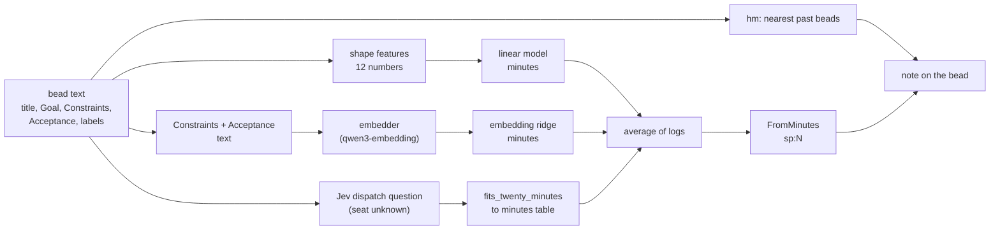

> Status: proposed 2026-11-11, awaiting the operator's approval (epic gt-5d9k2f).

# Story points: design

Epic: gt-5d9k2f. Author: eagle. Date: 2026-11-11. Status: for the operator's approval; no bead is released before it.

The evidence behind every number here is in [the retrospective](2026-11-11-story-points-retrospective.md), which is part of this design. The tasks are in [the plan](2026-11-11-story-points-plan.md).

## What this is for

The town hands each shaped bead to one polecat. Some beads take three minutes and some take an hour, and nothing says which before the polecat starts. A story point is a number written on the bead before dispatch that says how long it should take, and measured again after it lands. Three uses follow:

1. The overseer and the birds see which beads are big before they are dispatched.
2. A bead that is too big can be split before a polecat spends an hour on it.
3. The town learns how good its estimates are, and the estimates improve.

## Decisions already made

The operator decided these on 2026-11-11, through the overseer. They are not reopened here.

1. A point is polecat-minutes rounded to the nearest Fibonacci number (1, 2, 3, 5, 8, 13, 21, 34, 55, 89). The edges are the arithmetic midpoints between neighbours: 1.5, 2.5, 4, 6.5, 10.5, 17, 27.5, 44.5 and 72 minutes. No calibration is needed.
2. A bead whose a-priori estimate is over 21 points is split before dispatch. About 28 minutes is the edge.
3. The estimate is a blend of a shape-features model and Jev's `fits_twenty_minutes` answer. hm only names the nearest past beads in the estimate's note. If Jev is unavailable the shape model alone is used.
4. The shape model is a small model in Go with its weights in a checked-in JSON file, retrained monthly by `gt metrics`. A linear model first, kept if it clears 0.4; boosted trees only if it does not.
5. Shadow mode lasts a few hours. The live rank correlation is recomputed once 60 estimated beads have landed. The over-21 split turns on only at the operator's word.
6. The actual is the landing record's `polecat_secs`.

## What the retrospective changes

The retrospective was written before decisions 3 to 5 and was extended afterwards at the operator's request. Four findings matter for this design.

**1. The linear shape model is enough.** On the holdout (beads landed 11-03 to 11-06) a ridge-regression linear model on the shape features reaches rank correlation 0.49 against 0.50 for boosted trees. Decision 4 is met by the linear model; boosted trees are not needed.

**2. A ridge regression on an embedding earns a place, and it can replace Jev.** The operator asked whether a vector embedding could estimate complexity. Nearest-neighbour analogy cannot (0.29: topic dominates). A ridge regression from the embedding of the bead's Constraints and Acceptance text to log minutes can: 0.57 overall, 0.54 on the Haiku seat and 0.58 on the DeepSeek seat, as good as Jev's `fits_twenty_minutes` (0.57). Averaging the three estimators reaches 0.67 [0.61, 0.72]; shape plus embedding without Jev reaches 0.62; shape plus Jev reaches 0.64. The gains between blends sit inside the bootstrap interval, so none of the three blends is proven better than another. The embedding needs no model call and no spend.

**3. Jev's dispatch answers are logged after placement.** The retrospective used the dispatch log, whose lines are written a median of 7 minutes after a bead is attached to a seat, from the bead's sections. A true before-dispatch estimate must ask Jev itself, with the seat unknown. The logged answers and the pre-dispatch answers may differ slightly. Shadow mode measures the real one.

**4. The split rule, as worded, cannot fire.** A regression pulls estimates toward the middle. In 371 test beads the largest blended estimate is 20 to 23 minutes, and none is over 27.5. The 29 beads that really ran over 27.5 minutes (7.8%) cannot be found by "estimate over 21 points". A lower trigger works only weakly: flagging estimates of 15 minutes or more catches one long bead in five, and four in ten flagged beads run long. The design therefore treats the split rule as a flag for human review first. See [The split route](#the-split-route).

## The scale

A bead's points are `FromMinutes(m)`: the nearest Fibonacci number to the minutes, with the edges above. Against the 2,297 span-era beads of the Haiku and DeepSeek seats the scale spreads work well: points 3 to 21 hold about 90% of beads, and 11.8% of beads run over 21 points (over 27.5 minutes) and carry 51% of polecat time. The table is in the retrospective, section 7.

Two labels carry the values on a bead:

- `sp:N` is the estimate, written before dispatch.
- `sp-actual:N` is the measure, written when the bead lands.

## The estimate

`gt spec estimate <bead>` computes the estimate once and writes `sp:N` and a note.

**Inputs.**

- **Shape features.** Twelve numbers computed from the bead's text in the hm document layout (title line, then `## Description`, then any `## Acceptance` field): acceptance box count, distinct file names, distinct package paths, the log of the text length, constraint bullets, label count, a pod-engine flag, `test` mentions, backtick count, and indicators for the gastown and devops rigs and the Haiku seat. The exact definitions are in the plan, task SP5, and a fixture file of real beads pins the Go implementation to the Python that fitted the weights.
- **Embedding ridge.** The Constraints and Acceptance sections, headed `Constraints:` and `Acceptance:`, cut at 6,000 characters, embedded by `qwen3-embedding:4b-q8_0` (2,560 numbers), dotted with a weight vector, plus an intercept, exponentiated to minutes.
- **Jev.** The dispatch battery's `fits_twenty_minutes` probability, asked before dispatch with an empty agent, mapped to minutes by a monotone table fitted on the training period.

**Blend.** The inputs that exist are turned into minutes and averaged on the log scale with equal weight. The note says which inputs were used. The fallback ladder is decided by what is reachable:

| Reachable | Estimate | Holdout rank correlation (Haiku / DeepSeek) |
|---|---|---|
| all three | shape + embedding + Jev | 0.65 / 0.67 |
| no embedder | shape + Jev | 0.62 / 0.61 |
| no Jev | shape + embedding | 0.62 / 0.60 |
| neither | shape alone | 0.50 / 0.39 |

The correlations are on the 371-bead common holdout; the last row's DeepSeek figure is below the 0.4 bar, so an estimate made from shape alone is marked low-confidence in its note.

**hm's part.** `hm query` over the bead's title and Goal, limit five, gives the nearest past beads; their ids, titles and (when known) points go in the note. hm does not change the number.

**When it runs.** The estimate is computed when it is missing or when the hash of the bead's sections differs from the hash in the note. `gt spec lint` does not compute it (lint stays fast and offline). In shadow mode, the spec dispatcher tick runs the estimate for a bead it is about to sling, best effort with a time bound and failing open, so no estimate can delay or block a dispatch.

**Where it runs.** The dispatcher tick runs in the daemon pod. The embedder (ollama) and Jev's endpoint must be reachable from there. If either is not, the estimate falls down the ladder above. This is the main operational risk: see [Risks](#risks).

## The weights file

`internal/storypoints/weights.json` is embedded in the binary and checked in. It holds:

- the shape model: feature names, the mean and scale of each feature, the coefficients, the intercept;
- the `fits_twenty_minutes` to minutes table (a monotone list of points);
- the embedding ridge: model name, dimension, input description, intercept and the 2,560 coefficients (about 25 KB in all).

The first version is produced by the retrospective's harness and committed with this design as `docs/plans/2026-11-11-story-points-initial-weights.json`. It was trained on the 1,797 landed beads (10-26 to 11-06) that have hm text and a landing-record time. `gt metrics` retrains it monthly from the landings table and the bead text, writes the proposed file and a comparison with the checked-in one to the runtime directory, and never replaces the checked-in file itself: a person commits the change as a bead. A retrained model that does not clear 0.4 on its own holdout is reported, not adopted.

## The actual

When a landing is recorded, the landing worker writes `sp-actual:N` from the landing record's `polecat_secs`. Where the time is a lower bound (an attempt never closed) or absent, the label is not written and the report counts the bead as unmeasured. The landings table gains columns for `polecat_secs`, the lower-bound flag, the seat class (`agent`), `sp` and `sp_actual`, and the Jev answers, so the report and the monthly retrain read one table.

## Shadow mode and the report

Shadow mode is the estimate plus the label, with no effect on dispatch. A new `gt metrics` step reads the landings table and, once at least 60 estimated beads have landed, prints:

- the rank correlation of estimate and actual per seat class, with a bootstrap interval, against the 0.4 bar;
- the exact and within-one-bucket shares;
- for the split route, the number flagged at each candidate trigger, the precision and the recall;
- the count of estimated beads that landed unmeasured.

Below 60 estimated landings it prints the count and stops. The overseer brings the report to the operator, who decides on the split route. Landings run at about 120 a day for the two seat classes in the retrospective's data (the overseer's figure for all landings is about 230), so 60 estimated beads take a few hours once the hook is on.

## The split route

The route is behind a setting, `patrols.spec_dispatch.story_points.split_over`, default off (0), and its bead is held for the operator's word.

The operator's rule reads "over 21 points splits". The retrospective shows that no estimate reaches 21 points, so the route is built on a minutes trigger, and the setting holds that trigger. When the trigger fires, the dispatcher does not sling the bead; it adds the existing split label (`SplitLabel` in `internal/specdispatch/dispatch.go`, which already keeps a bead off the dispatcher) and a comment with the estimate and the nearest beads, for the overseer or a bird to split. It never splits a bead by itself.

Choosing the trigger is the operator's decision at the recompute. The retrospective's sweep gives the shape: at 15 estimated minutes about 4% of beads are flagged, four in ten of them run long and one long bead in five is caught; at 13 minutes 11% are flagged, three in ten run long and four in ten of the long beads are caught. The shadow report recomputes this table on live estimates.

## Risks

1. **The embedder is on the Mac.** The estimate runs in the daemon pod, and ollama listens on the Mac's loopback. The embedder endpoint is a setting, and unreachable means the ladder falls back, so correctness does not depend on it. If the operator wants the full blend in the pod, the embedder must be exposed to the cluster, or the embedding must move. This is an open question for the overseer.
2. **Jev's pre-dispatch answer is not the logged answer.** The retrospective measured logged answers. The shadow recompute is the first measurement of the real thing.
3. **Four-day holdout.** All holdout figures come from beads landed 11-03 to 11-06 (Jev: to 11-11). The shadow recompute with 60 beads is small too; the monthly retrain is the real calibration.
4. **Rework is noise the estimate cannot see.** Beads that need several om rounds take three times as long. The estimate predicts the work, not the rejections.
5. **Shape model drift.** The weights fit the town's present beads and seats. A change of seat model or bead template moves the distribution; the monthly retrain and its report are the check.
6. **The 0.4 bar is a rank bar.** Exact-bucket accuracy is only 0.3 to 0.4 for every estimator, and within one bucket 0.7 to 0.8. A point is a good ordering of beads, not a good prediction of minutes.

## Out of scope

- Changing what a polecat does with an estimate (no seat routing by points).
- Using points to price or schedule beyond the split flag.
- Estimating rework or rejection.
- Any per-seat scale: one scale for all seats, with the seat recorded.
