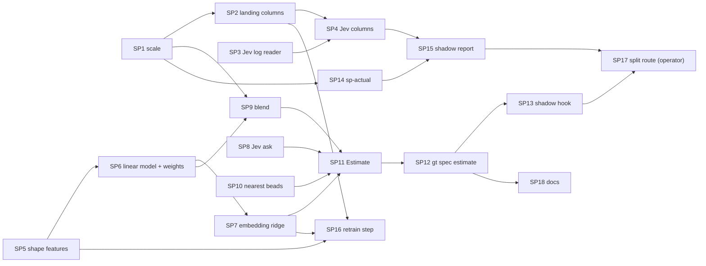

> Status: proposed 2026-11-11; the tasks are filed held until the design is approved.

# Story points: plan

Epic: gt-5d9k2f. Design: [story-points-design](2026-11-11-story-points-design.md). Evidence: [retrospective](2026-11-11-story-points-retrospective.md). Author: eagle, 2026-11-11.

Eighteen tasks, each about twenty minutes of one polecat's work: Go with unit tests, boxes the polecat can tick alone, no live town needed. They are filed as shaped beads under gt-5d9k2f, held with `needs-overseer` until the operator approves the design, with dependencies wired.

## Order



SP1, SP3, SP5, SP8 and SP10 have no dependencies and can run in parallel. Everything is filed held; the overseer releases in order.

## Shared definitions

**Package.** New package `internal/storypoints`. It imports no other internal package except `internal/hmhints` (SP10) and standard library; the command code lives in `internal/cmd`.

**Scale.** `FromMinutes(m float64) int` returns the nearest Fibonacci number from this list, by the edge values, rounding a value exactly on an edge up: 1 up to 1.5; 2 up to 2.5; 3 up to 4; 5 up to 6.5; 8 up to 10.5; 13 up to 17; 21 up to 27.5; 34 up to 44.5; 55 up to 72; 89 above. Zero or negative minutes is an error, not point 1.

**Labels.** `sp:N` and `sp-actual:N`, N a Fibonacci number from the list.

**The estimate text.** The text the features and the embedding are computed from is the bead as hm lays it out, cut before the first note or comment:

```
# <title> [<status> <type> P<priority>] labels: <label>, <label>

## Description

<description, which holds the Goal, Constraints, Out of scope, Gate, Size and Acceptance sections>

## Acceptance

<acceptance_criteria field, when it is not empty>
```

The `labels:` part is left out when there are no labels. The weights were fitted on this layout.

**Shape features.** All counted on the estimate text `t`. A "word character" is `[A-Za-z0-9_]`; the fixture file pins the cases where Python's Unicode `\w` and Go's ASCII `\w` could differ.

| Feature | Definition |
|---|---|
| `boxes` | number of lines starting `- [ ]`, `- [x]` or `- [X]` in the text from the last `## Acceptance` heading to the end (0 when there is none) |
| `paths` | number of distinct matches of `[\w][\w./-]*\.(go\|md\|yaml\|yml\|sh\|json\|txt\|html\|py\|ts\|tsx\|sql\|mod)\b` |
| `pkgs` | number of distinct matches of `\b(internal\|cmd\|deploy\|docs)/[\w-]+` |
| `dlen` | natural log of (1 + number of characters of `t`) |
| `ncons` | number of lines starting `- ` in the section from `## Constraints` to the next line starting `## ` (0 when there is none) |
| `nlab` | number of comma-separated labels on the first line after `labels: ` (0 when none) |
| `podeng` | 1 when `t` contains `pod-engine`, else 0 |
| `tests` | number of matches of `\btest` |
| `nbt` | number of backtick characters |
| `rig_gt` | 1 when the bead's rig is gastown |
| `rig_dv` | 1 when the bead's rig is devops |
| `is_haiku` | 1 when the seat class is the Haiku class; at estimate time, before a seat is chosen, 0 |

Before dispatch the seat is unknown, so `is_haiku` is 0 and the model's seat term (a small negative coefficient) is not applied.

**Fixtures.** `docs/plans/2026-11-11-story-points-shape-fixtures.json` holds six real beads: their estimate text, the features the fitting harness computed, and the linear model's predicted minutes. SP5 and SP6 test against it.

**Initial weights.** `docs/plans/2026-11-11-story-points-initial-weights.json`, committed with this plan. SP6 copies it to `internal/storypoints/weights.json`.

## Tasks

### SP1. The scale

New `internal/storypoints/points.go`: `FromMinutes`, `Edges`, `Valid(n)`, `SPLabel(n)` and `ActualLabel(n)` returning `sp:N` and `sp-actual:N`, `ParseLabel(s)` returning kind and N, and `ErrNoMinutes`. Table tests over every edge and the value just below and above it, and over parse round trips and rejects (`sp:4`, `sp:`, `sp-actual:0`).
Depends: none. Gate: `go test ./internal/storypoints -count=1`.

### SP2. Landings table columns for polecat time

In `internal/metrics`: `LedgerRow` (see `loaders_ledger.go`) gains `polecat_secs`, `polecat_lower_bound` and `agent` read from the landing ledger line (they are written by the landing worker since 10-26); `landingColumns` in `landings.go` is append-only and gains `polecat_secs`, `polecat_lower_bound`, `agent`, `seat_class` and `sp_actual`. `seat_class` is `haiku` for agents `sbx-haiku` and `claude-haiku`, `flash` for `sbx-flash` and names starting `deepseek`, `sonnet` for `claude-sonnet`, and empty otherwise. `sp_actual` is `storypoints.FromMinutes(polecat_secs/60)` when the time is present, not a lower bound and positive, else empty. Golden files and the footer counts follow.
Depends: SP1. Gate: `go test ./internal/metrics -count=1`.

### SP3. A reader for the whole Jev dispatch log

In `internal/jev/dispatch` (see `store.go`, which has `ReadRecent`): add `ReadAll(path string) ([]Line, error)` that reads every line, skips a malformed line and counts it, and `FirstPerBead(lines []Line) map[string]Line` that keeps the earliest line by `TS` per bead. Tests with a temp file: empty file, a malformed line, a bead logged twice, a missing file (error).
Depends: none. Gate: `go test ./internal/jev/dispatch -count=1`.

### SP4. Jev columns in the landings table

In `internal/metrics`: read the Jev dispatch log path (`dispatch.LogPath`, see `store.go`), take `FirstPerBead`, and add the columns `jev_fits20` and `jev_size` to `landingColumns` (append-only), empty for a bead with no line. A missing log leaves the columns empty and is noted in the footer, not an error.
Depends: SP2, SP3. Gate: `go test ./internal/metrics -count=1`.

### SP5. Shape features

New `internal/storypoints/shape.go`: `EstimateText(issue)` building the text above from a `beads.Issue`, and `Features(text, rig string, haiku bool) Shape` with the twelve features. Test table from the fixture file (read it with a relative path from the test), plus edge cases: empty description, no Acceptance heading, a bead with labels and one without, a text with a path in a backtick.
Depends: none. Gate: `go test ./internal/storypoints -count=1`.

### SP6. The linear model and the weights file

Create `internal/storypoints/weights.json` by copying `docs/plans/2026-11-11-story-points-initial-weights.json`; embed it with `go:embed`. New `internal/storypoints/model.go`: `LoadWeights(r io.Reader) (Weights, error)` that rejects a file with a feature-name list that differs from the code's, a wrong-length coefficient list, a zero scale, or a NaN; `(Weights).ShapeMinutes(Shape) float64` computing `exp(intercept + sum(coef_i * (x_i - mean_i) / scale_i))`; `Default()` returning the embedded weights. Tests: every fixture bead's predicted minutes within 0.01 of the fixture's, and one test per rejection.
Depends: SP5. Gate: `go test ./internal/storypoints -count=1`.

### SP7. The embedding ridge

New `internal/storypoints/embed.go`: `SectionText(issue)` building the text `Constraints:\n<section>\n\nAcceptance:\n<section>` (a missing section is left out; none at all returns an error), cut at 6,000 characters; `type Embedder interface { Embed(ctx, text) ([]float32, error) }`; an HTTP client `OllamaEmbedder{URL, Model, Timeout}` posting `{"model":..., "input":[text]}` to `<URL>/api/embed` and reading `embeddings[0]`, rejecting a wrong dimension; and `(Weights).EmbeddingMinutes(vec []float32) (float64, error)` computing `exp(intercept + dot(coef, vec))`. Tests with `httptest`: a good reply, a timeout, a wrong dimension, an error status; the dot product on a synthetic vector.
Depends: SP6. Gate: `go test ./internal/storypoints -count=1`.

### SP8. Ask Jev before dispatch

In `internal/jev/dispatch` (see `dispatch.go`, `buildState` and `Pass.choose`): export `Ask(ctx, asker Asker, b *beads.Issue) (Answers, error)` that builds the state with the agent field empty, asks the same questions as the pass, and returns the answers, without writing the dispatch log or touching the cursor. The existing pass behavior is unchanged. Tests with a fake asker: the state sent has an empty agent, the log is not written, an asker error is returned.
Depends: none. Gate: `go test ./internal/jev/dispatch -count=1`.

### SP9. The blend and the fallback ladder

New `internal/storypoints/blend.go`: `Blend(in Inputs) (Blended, error)` where `Inputs` holds optional minutes from shape, embedding and Jev (Jev as the `fits_twenty_minutes` probability, mapped to minutes by the weights' monotone table with linear interpolation and clipping at the ends). It averages the logs of the inputs present with equal weight, returns minutes, the points from `FromMinutes`, and the list of inputs used; no input at all is an error. `Confidence` is `low` when only the shape input is present. Tests: each rung of the ladder, the interpolation at the table's ends, a probability outside 0 to 1 rejected.
Depends: SP1, SP6. Gate: `go test ./internal/storypoints -count=1`.

### SP10. Nearest past beads

New `internal/storypoints/neighbors.go`: `Nearest(ctx, run hmhints.Runner, issue, limit int) ([]Neighbor, error)` that queries hm with the bead's title and Goal (through `hmhints.Query`), keeps hits of kind `bead`, drops the bead itself, and returns id, rig and title. An hm failure returns an empty list and the error, and the caller proceeds without neighbours. Tests with a fake runner.
Depends: none. Gate: `go test ./internal/storypoints -count=1`.

### SP11. The Estimate function

New `internal/storypoints/estimate.go`: `Estimate(ctx, deps Deps, issue) (Result, error)` where `Deps` holds the weights, an `Embedder`, a Jev asker function and an hm runner (each optional). It builds the inputs that can be built (an input whose dependency is nil or fails is skipped and the reason recorded), blends, finds the neighbours, and returns the points, minutes, inputs used, skipped reasons, neighbours, and a `Hash` of the section text. `Note(Result)` renders the comment text: first line `SP ESTIMATE v1 sp:N hash:<hash>`, then the minutes, the inputs used, the skipped inputs and the nearest beads. Tests with fakes for every dependency, including all dependencies failing (shape only, low confidence).
Depends: SP6, SP7, SP8, SP9, SP10. Gate: `go test ./internal/storypoints -count=1`.

### SP12. `gt spec estimate`

New `internal/cmd/spec_estimate.go`: `gt spec estimate <bead-id> [--force] [--dry-run] [--json]`. It reads the bead, finds the latest comment beginning `SP ESTIMATE v1` and its hash, and does nothing when the bead's section hash is unchanged (unless `--force`). Otherwise it runs `Estimate`, removes any existing `sp:` label, adds the new one, and adds the note as a comment. `--dry-run` prints and writes nothing. Every bead write goes through the `bd` wrapper the other spec commands use (see `internal/cmd/spec.go`). Tests with the command's existing fake bead store.
Depends: SP11. Gate: `go test ./internal/cmd -run 'SpecEstimate' -count=1`.

### SP13. The shadow hook in the dispatcher tick

In the spec dispatcher tick (see `internal/cmd/spec.go`): behind the setting `patrols.spec_dispatch.story_points.shadow` (default false), call the estimate for a bead just before it is slung, best effort, with a timeout of 20 seconds, failing open: an error or timeout logs one line and the sling proceeds unchanged. The setting is read through the existing patrol config, not a new `GT_` environment read. Tests: setting off does nothing, setting on estimates, an error does not stop the sling, a timeout does not stop the sling.
Depends: SP12. Gate: `go test ./internal/cmd -run 'SpecDispatch.*StoryPoint' -count=1`.

### SP14. `sp-actual` at landing

In the landing worker (see `internal/landworker/worker.go`, after the landing record is written): compute `sp-actual:N` from the record's `polecat_secs` and add the label to the work bead; skip when the time is absent, zero or a lower bound, and when the bead has no `sp:` label (so shadow mode's report counts only estimated beads). A label write failure is logged and does not undo or retry the landing. Tests with the worker's fakes.
Depends: SP1. Gate: `go test ./internal/landworker -count=1`.

### SP15. The shadow report

New `gt metrics storypoints` step (see `townMetricsCommands` in `internal/cmd/metrics.go`; logic in `internal/metrics`): read the landings table, keep rows with both `sp` and `sp_actual`, and when there are at least 60, print per seat class the count, Spearman rank correlation with a bootstrap 95% interval (fixed seed, 400 resamples), the exact and within-one shares, and for trigger minutes 11, 13, 15 and 17 the number flagged, precision and recall against actual points over 21; below 60 print the count and stop. Add the `sp` column to the landings table from the bead's label. Tests with a synthetic table of known correlation.
Depends: SP4, SP14. Gate: `go test ./internal/metrics -count=1`.

### SP16. The monthly retrain step

New `gt metrics storypoints-train` step: from the landings table (rows with `polecat_secs`, not a lower bound, seat class haiku or flash) and each bead's estimate text, fit the shape ridge (alpha by leave-out over time-ordered folds from a fixed list) and the embedding ridge, write a proposed weights file and a comparison report (rank correlation of the checked-in and the proposed weights on the latest 20% of dates) under the runtime directory. It never writes `internal/storypoints/weights.json`. The linear solve is closed form and unit-tested against a known solution.
Depends: SP2, SP5, SP7. Gate: `go test ./internal/metrics ./internal/storypoints -count=1`.

### SP17. The split route (held for the operator)

In the spec dispatcher tick, behind `patrols.spec_dispatch.story_points.split_over_minutes` (default 0, meaning off): when set and a bead's blended minutes are at least the setting, do not sling it; add the existing split label (`SplitLabel` in `internal/specdispatch/dispatch.go`) and a comment with the estimate and the nearest beads; log one line. A bead already carrying `sp:` and the label is not touched again. Tests: off does nothing, on flags, an estimate below the trigger is slung.
Depends: SP13, SP15, and the operator's word after the shadow report. Gate: `go test ./internal/cmd -run 'SpecDispatch.*Split' -count=1`.

### SP18. Documentation

In `docs/reference.md` add a "Story points" section: the scale, the two labels, `gt spec estimate`, the settings, the report and the retrain step, the fallback ladder. Add `story point` to `docs/glossary.md`. No claim about a value not in the code.
Depends: SP12. Gate: `go run ./cmd/docs-lint`.

## What each task leaves out

- No task changes seat routing or the pool.
- Only SP17 can change what is dispatched, and it ships off.
- Only SP14 writes after landing, and a failure there never blocks a landing.
- No task commits a weights change: SP16 proposes, a person adopts.

## Open questions for the overseer

1. The estimate runs in the daemon pod; the embedder is on the Mac. Do we expose ollama to the cluster, or accept the Jev-plus-shape rung in the pod?
2. Jev's `fits_twenty_minutes` is asked before dispatch (SP8): is the spend inside the existing Jev daily cap acceptable, about one call per dispatched bead?
3. The setting names above are mine; rename them before SP13 if the patrol config has a convention.
